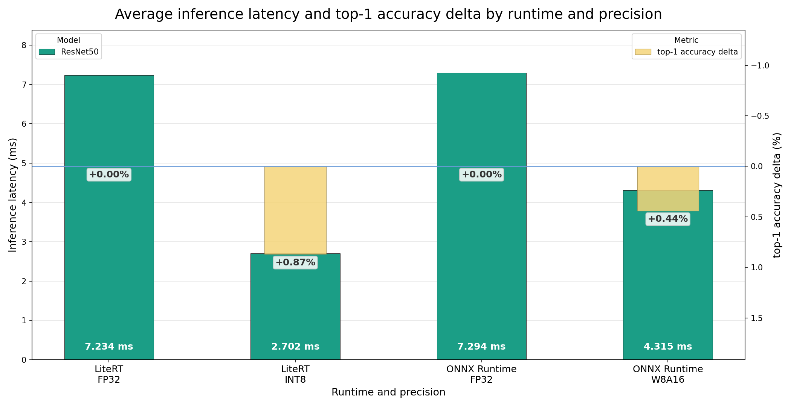

<!--
 Copyright (c) 2025 Innodisk Corp.

 This software is released under the MIT License.
 https://opensource.org/licenses/MIT
-->

# iQ-Foundry Classification Model Benchmark

This benchmark compares [iQ-Foundry](https://github.com/InnoIPA/iQ-Foundry) image-classification model conversions and their measured performance on EXMP-Q911 (Qualcomm IQ-9075).

## Overview

This page compares the classification accuracy, deployment size, and on-device inference performance of the classification model combinations supported by [iQ-Foundry](https://github.com/InnoIPA/iQ-Foundry). The results help users select an appropriate model based on accuracy, inference latency, model size, runtime compatibility, and deployment requirements.

These results provide comparison data rather than a universal model ranking. Select a model according to the requirements of your application and deployment environment.

## Hardware and Benchmark Environment

### Hardware

| Item | Configuration |
| --- | --- |
| Target device | EXMP-Q911 (Qualcomm IQ-9075) |
| Inference accelerator | Qualcomm HTP/NPU |
| Power plan | 30 W (High Performance mode) |
| AI performance | 100 TOPS (Dense) |

### Benchmark Environment

| Item | Configuration |
| --- | --- |
| iQ-Foundry version | v1.1.0 |
| Dataset | [Imagenette](https://github.com/fastai/imagenette) (`imagenette2-160`), a 10-class subset of ImageNet |
| Evaluation subset | 300 validation images, 30 per class |
| Evaluation images | 300 |
| Preprocessing | Resize short side to 256, center crop 224 × 224, RGB |
| Reference model | Pretrained ResNet50 (`IMAGENET1K_V2`) from [torchvision](https://docs.pytorch.org/vision/stable/models/generated/torchvision.models.resnet50.html) |

> [!NOTE]
> All accuracy evaluations and inference-latency measurements used 300 images from the Imagenette validation set. The reference model was the pretrained torchvision ResNet50 (`IMAGENET1K_V2`, 1000 ImageNet classes), and all converted models were generated and evaluated using iQ-Foundry. Because Imagenette is a subset of ImageNet, the model keeps all 1000 classes and a prediction counts as correct only when it matches the image's ImageNet class. Inference latency refers to model invocation latency rather than complete application pipeline latency.

## How to Read the Results (Metrics)

| Metric | Description | Preferred Direction |
| --- | --- | --- |
| Converted top-1 accuracy | Share of images whose highest-scoring class is correct, after conversion. | Closer to the reference top-1 accuracy is better |
| Top-1 delta | Percentage change of top-1 accuracy relative to the original reference model. A negative value indicates lower measured accuracy after conversion; a positive value indicates a slightly higher result on this evaluation subset. | Closer to 0% is better |
| Top-5 accuracy | Share of images whose correct class is among the five highest-scoring classes. | Closer to the reference value is better |
| Inference time | Average model invocation latency on the target device. | Lower is better |
| Model size | Storage size of the converted deployment model. | Lower is better |

## Benchmark Overview



The chart provides a visual comparison of top-1 accuracy change and model invocation latency across runtime and precision combinations.

> [!NOTE]
> **Benchmark conversion configuration:** quantized conversions used the MSE quantization scheme.

## Results

### LiteRT

| Model | Precision | Top-1 (Reference) | Top-1 (Converted) | Top-1 Delta (%) | Top-5 (Reference) | Top-5 (Converted) | Inference Time (ms) | Model Size (MB) |
| --- | --- | ---: | ---: | ---: | ---: | ---: | ---: | ---: |
| resnet50 | FP32 | 0.7633 | 0.7633 | +0.00% | 0.9100 | 0.9100 | 7.234 | 102.2 |
| resnet50 | INT8 | 0.7633 | 0.7700 | +0.87% | 0.9100 | 0.9067 | 2.702 | 26.3 |

### ONNX Runtime

| Model | Precision | Top-1 (Reference) | Top-1 (Converted) | Top-1 Delta (%) | Top-5 (Reference) | Top-5 (Converted) | Inference Time (ms) | Model Size (MB) |
| --- | --- | ---: | ---: | ---: | ---: | ---: | ---: | ---: |
| resnet50 | FP32 | 0.7633 | 0.7633 | +0.00% | 0.9100 | 0.9067 | 7.294 | 95.3 |
| resnet50 | W8A16 | 0.7633 | 0.7667 | +0.44% | 0.9100 | 0.9100 | 4.315 | 44.0 |

## Conclusion

There is no single best model for every deployment. Choose a model by considering the accuracy you can accept, the latency and model-size limits, and the runtime you deploy on.

- FP32 matches the reference top-1 accuracy (0.7633). The quantized models differ by one or two pictures out of 300, so a change of about 1% in top-1 on this subset is within the measurement noise rather than a real gain or loss.
- LiteRT INT8 is the smallest (26.3 MB, about a quarter of FP32) and fastest (2.7 ms, against 7.2 ms for FP32), with top-1 0.7700 and top-5 0.9067.
- ONNX W8A16 keeps top-1 at 0.7667, runs in 4.3 ms against 7.3 ms for ONNX FP32, and is smaller (44.0 MB against 95.3 MB).

For application-based recommendations, see the [iQ-Foundry Model Selection Guide](../../../tutorials/model-deploy/iqf-model-guide/README.md).

## Benchmark and Deploy Your Model

Use the following workflow to convert a ResNet50 model, evaluate its converted accuracy, deploy it to EXMP-Q911, and measure model invocation latency. Before starting, complete the iQ-Foundry host setup for your operating system:

- [Windows Host Guide](https://github.com/InnoIPA/iQ-Foundry/blob/main/Windows_host.md)
- [Ubuntu Host Guide](https://github.com/InnoIPA/iQ-Foundry/blob/main/Ubuntu_host.md)

The workflow has three stages:

1. Convert the model for the selected runtime and precision using `qc`.
2. Compare the reference and converted model accuracy using `eval`.
3. Deploy the converted model through ADB and measure invocation latency using `test`.

Replace the placeholder paths in the commands below with the paths for your model and evaluation data.

### Model Requirements

- A torchvision `resnet50` architecture, saved as a state_dict only (`.pt` / `.pth`).
- The model outputs raw logits (no softmax).
- Trained with ImageNet mean / std normalization and 224 × 224 input. Do not add the normalization to the model yourself: `qc` adds it.

### Class Names YAML

`eval` and `test` need a YAML file that lists the class names in the model's output order:

```yaml
names:
  - class_0
  - class_1
  # ... one entry per model output
```

### Convert the Model for Deployment

Run the following command from the iQ-Foundry repository root to create a deployment model:

```bash
./docker/iqf run qc \
  --type resnet50 \
  --task classify \
  --runtime <litert|onnx> \
  --precision <fp32|int8|w8a16> \
  --model /path/to/resnet50.pth \
  --calib_dir /path/to/calibration_images
```

> Note: `--calib_dir` is required for quantized conversion. Omit `--calib_dir` for FP32 conversion.

Use one of the following runtime and precision supported combinations:

| Runtime | Precision |
| --- | --- |
| LiteRT | FP32 |
| LiteRT | INT8 |
| ONNX Runtime | FP32 |
| ONNX Runtime | W8A16 |

### Evaluate Conversion Accuracy

Put the evaluation images in one folder per class, named exactly as in the class names YAML:

```text
validation_images/
├── class_0/
│   ├── image_001.jpg
│   └── ...
├── class_1/
└── ...
```

Compare the reference and converted model top-1 and top-5 accuracy:

```bash
./docker/iqf run eval \
  --type resnet50 \
  --task classify \
  --runtime <litert|onnx> \
  --precision <fp32|int8|w8a16> \
  --images /path/to/validation_images \
  --yaml /path/to/classes.yaml \
  --reference-model /path/to/resnet50.pth \
  --converted-model /path/to/converted_model \
  --max-images 300
```

The generated report contains the reference and converted top-1 and top-5 accuracy. Use these results to assess the accuracy impact of conversion for your deployment.

### Deploy and Measure Inference Latency

Deploy the converted model to EXMP-Q911 through ADB and measure model invocation latency:

```bash
./docker/iqf run test \
  --type resnet50 \
  --task classify \
  --runtime <litert|onnx> \
  --precision <fp32|int8|w8a16> \
  --model /path/to/converted_model \
  --yaml /path/to/classes.yaml \
  --images /path/to/benchmark_images \
  --adb
```

The target EXMP-Q911 must be connected and visible through ADB. To compare your latency result with this page, `/path/to/benchmark_images` should contain the same 300 Imagenette validation images used for the published benchmark.

At the end of the command output, record:

```text
avg_model_invoke_ms
```

This value represents the average model invocation latency.

> [!IMPORTANT]
> Use evaluation data that represents your deployment requirements. When comparing your results with this benchmark, use the same dataset, image subset, device, power mode, runtime, and latency-measurement method. Results may vary with device software, runtime versions, model conversion settings, calibration data, thermal state, and application workload.
