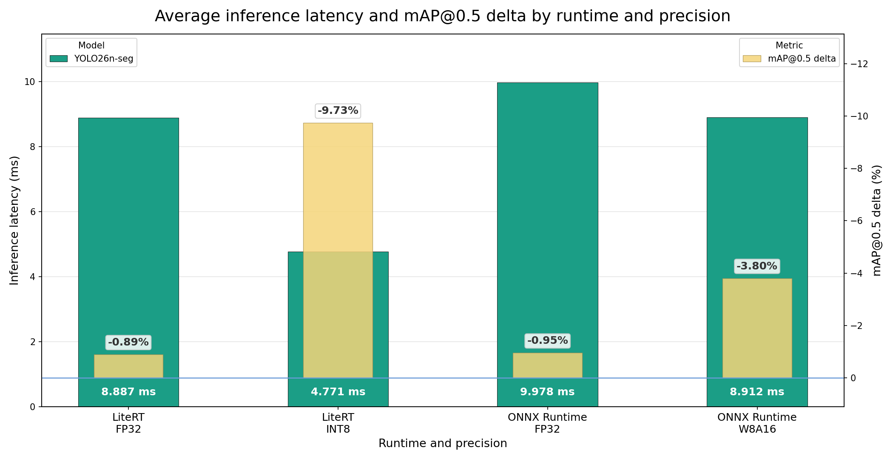

<!--
 Copyright (c) 2025 Innodisk Corp.

 This software is released under the MIT License.
 https://opensource.org/licenses/MIT
-->

# iQ-Foundry Segmentation Model Benchmark

This benchmark compares [iQ-Foundry](https://github.com/InnoIPA/iQ-Foundry) instance-segmentation model conversions and their measured performance on EXMP-Q911 (Qualcomm IQ-9075).

## Overview

This page compares the mask accuracy, deployment size, and on-device inference performance of the segmentation model combinations supported by [iQ-Foundry](https://github.com/InnoIPA/iQ-Foundry). The results help users select an appropriate model based on accuracy, inference latency, model size, runtime compatibility, and deployment requirements.

These results provide comparison data rather than a universal model ranking. Select a model according to the requirements of your application and deployment environment.

## Hardware and Benchmark Environment

### Hardware

| Item | Configuration |
| --- | --- |
| Target device | EXMP-Q911 (Qualcomm IQ-9075) |
| Inference accelerator | Qualcomm HTP/NPU |
| Power plan | 30 W (High Performance mode) |
| AI performance | 100 TOPS (Dense) |

### Benchmark Environment

| Item | Configuration |
| --- | --- |
| Dataset | [COCO 2017 validation dataset](https://cocodataset.org/#download) |
| Evaluation subset | First 300 validation images |
| Evaluation images | 300 |
| Confidence threshold | 0.25 |
| NMS IoU threshold | 0.7 |
| Maximum detections | 300 |
| Reference model | Pretrained YOLO26n-seg model from [Ultralytics](https://docs.ultralytics.com/tasks/segment/) |

> [!NOTE]
> All mAP evaluations and inference-latency measurements used the first 300 images from the COCO 2017 validation dataset. The reference model was the pretrained YOLO26n-seg model obtained from Ultralytics, and all converted models were generated and evaluated using iQ-Foundry. Accuracy is scored on the predicted masks (COCO mask IoU). Inference latency refers to model invocation latency rather than complete application pipeline latency.

## How to Read the Results (Metrics)

| Metric | Description | Preferred Direction |
| --- | --- | --- |
| Converted mAP@0.5 | Measured mask accuracy (mask mAP at IoU 0.5) after conversion. | Closer to the reference mAP@0.5 is better |
| mAP delta | Percentage change of mAP@0.5 relative to the original reference model. A negative value indicates lower measured accuracy after conversion; a positive value indicates a slightly higher result on this evaluation subset. | Closer to 0% is better |
| mAP@0.5:0.95 | Mask accuracy (mask mAP averaged over IoU 0.5 to 0.95), listed for comparison with the Ultralytics model table. | Closer to the reference value is better |
| Inference time | Average model invocation latency on the target device. | Lower is better |
| Model size | Storage size of the converted deployment model. | Lower is better |

## Benchmark Overview



The chart provides a visual comparison of mAP change and model invocation latency across runtime and precision combinations.

> [!NOTE]
> **Benchmark conversion configuration:** YOLO26n-seg used the one-to-many (`O2M`) output head, and its quantized conversions used the MSE quantization scheme.

## Results

### LiteRT

| Model | Precision | mAP@0.5 (Reference) | mAP@0.5 (Converted) | mAP Delta (%) | mAP@0.5:0.95 (Reference) | mAP@0.5:0.95 (Converted) | Inference Time (ms) | Model Size (MB) |
| --- | --- | ---: | ---: | ---: | ---: | ---: | ---: | ---: |
| yolo26n-seg | FP32 | 0.4925 | 0.4881 | -0.89% | 0.3054 | 0.3069 | 8.887 | 11.0 |
| yolo26n-seg | INT8 | 0.4925 | 0.4446 | -9.73% | 0.3054 | 0.2696 | 4.771 | 3.1 |

### ONNX Runtime

| Model | Precision | mAP@0.5 (Reference) | mAP@0.5 (Converted) | mAP Delta (%) | mAP@0.5:0.95 (Reference) | mAP@0.5:0.95 (Converted) | Inference Time (ms) | Model Size (MB) |
| --- | --- | ---: | ---: | ---: | ---: | ---: | ---: | ---: |
| yolo26n-seg | FP32 | 0.4925 | 0.4878 | -0.95% | 0.3054 | 0.3067 | 9.978 | 9.7 |
| yolo26n-seg | W8A16 | 0.4925 | 0.4738 | -3.80% | 0.3054 | 0.2939 | 8.912 | 5.6 |

## Conclusion

There is no single best model for every deployment. Choose a model by considering the accuracy you can accept, the latency and model-size limits, and the runtime you deploy on.

- FP32 stays within 1% of the reference mask mAP@0.5. On mAP@0.5:0.95 it is on par with the reference (a slightly higher value on this subset).
- LiteRT INT8 is the smallest (3.1 MB) and fastest (4.8 ms, against 8.9 to 10.0 ms for the others), but it loses the most accuracy: -9.73% mAP@0.5 and -11.7% mAP@0.5:0.95. Segmentation is more sensitive to INT8 than detection or pose in this benchmark.
- ONNX W8A16 loses 3.80% of mAP@0.5. It is about 40% smaller than ONNX FP32 (5.6 MB against 9.7 MB) and slightly faster (8.9 ms against 10.0 ms).

For application-based recommendations, see the [iQ-Foundry Model Selection Guide](../../../tutorials/model-deploy/iqf-model-guide/README.md).

## Benchmark and Deploy Your Model

Use the following workflow to convert a supported segmentation model, evaluate its converted accuracy, deploy it to EXMP-Q911, and measure model invocation latency. Before starting, complete the iQ-Foundry host setup for your operating system:

- [Windows Host Guide](https://github.com/InnoIPA/iQ-Foundry/blob/main/Windows_host.md)
- [Ubuntu Host Guide](https://github.com/InnoIPA/iQ-Foundry/blob/main/Ubuntu_host.md)

The workflow has three stages:

1. Convert the model for the selected runtime and precision using `qc`.
2. Compare the reference and converted model accuracy using `eval`.
3. Deploy the converted model through ADB and measure invocation latency using `test`.

Replace the placeholder paths in the commands below with the paths for your model and evaluation data.

### Convert the Model for Deployment

Run the following command from the iQ-Foundry repository root to create a deployment model:

```bash
./docker/iqf run qc \
  --type yolov26 \
  --task segment \
  --runtime <litert|onnx> \
  --precision <fp32|int8|w8a16> \
  --model /path/to/yolo26n-seg.pt \
  --calib_dir /path/to/calibration_images
```

> Note: `--calib_dir` is required for quantized conversion. Omit `--calib_dir` for FP32 conversion.

Use one of the following runtime and precision supported combinations:

| Runtime | Precision |
| --- | --- |
| LiteRT | FP32 |
| LiteRT | INT8 |
| ONNX Runtime | FP32 |
| ONNX Runtime | W8A16 |

### Evaluate Conversion Accuracy

Compare the reference and converted model mask accuracy:

```bash
./docker/iqf run eval \
  --type yolov26 \
  --task segment \
  --runtime <litert|onnx> \
  --precision <fp32|int8|w8a16> \
  --annotations /path/to/annotations.json \
  --images /path/to/validation_images \
  --reference-model /path/to/yolo26n-seg.pt \
  --converted-model /path/to/converted_model \
  --conf 0.25 \
  --nms 0.7 \
  --max-det 300 \
  --max-images 300
```

The generated report contains the reference and converted mask mAP@0.5 and mAP@0.5:0.95. Use these results to assess the accuracy impact of conversion for your deployment.

### Deploy and Measure Inference Latency

Deploy the converted model to EXMP-Q911 through ADB and measure model invocation latency:

```bash
./docker/iqf run test \
  --type yolov26 \
  --task segment \
  --runtime <litert|onnx> \
  --precision <fp32|int8|w8a16> \
  --model /path/to/converted_model \
  --yaml /path/to/classes.yaml \
  --images /path/to/benchmark_images \
  --conf 0.25 \
  --nms 0.7 \
  --max-det 300 \
  --adb
```

The target EXMP-Q911 must be connected and visible through ADB. To compare your latency result with this page, `/path/to/benchmark_images` should contain the same first 300 COCO validation images used for the published benchmark.

At the end of the command output, record:

```text
avg_model_invoke_ms
```

This value represents the average model invocation latency.

> [!IMPORTANT]
> Use evaluation data that represents your deployment requirements. When comparing your results with this benchmark, use the same dataset, image subset, thresholds, device, power mode, runtime, and latency-measurement method. Results may vary with device software, runtime versions, model conversion settings, calibration data, thermal state, and application workload.
