<!--
 Copyright (c) 2025 Innodisk Corp.

 This software is released under the MIT License.
 https://opensource.org/licenses/MIT
-->

# Multi-stream inference status on Jetson Orin NX and Qualcomm IQ-8275

This topic describes a multi-stream inference benchmark for the iQS-Streampipe
application on the NVIDIA Jetson Orin NX 16GB and the Qualcomm Dragonwing
IQ-8275 platform. The purpose is to observe execution behavior as the number of
channels and the video resolution increase. The results are not intended to be
a general hardware performance ranking.

- Application: [iQS-Streampipe](../../tutorials/applications/iqs-streampipe/README.md)
- Task: object detection with an INT8 model
- Input: 720p, 1080p, 2K, and 4K, 30 FPS H.264 video streams
- Platforms: NVIDIA Jetson Orin NX 16GB, IQ-8275 (Qualcomm Dragonwing QCS8275)
- Metrics:
  - Output average end-to-end FPS per channel
  - Average CPU loading (%)
  - Average CPU memory usage (%)
  - Power (W) and FPS/Watt
  - Output end-to-end FPS percentiles (P95, P75, P50, P25)
- Channel counts: 1, 4, 9, and 16 at 720p and 1080p; 1, 4, and 9 at 2K; 1 and 4 at 4K

> Note: Qualcomm specifies the video decode of the IQ-8275 as 2× 4K60, 4× 4K30, 8× 1080p60, and 16× 1080p30 (formats: AV1, H.264, H.265/HEVC, VP9, and MPEG-2).

## Hardware

The benchmark uses two edge AI platforms with the configurations shown below.

| **Platform**        | NVIDIA Jetson Orin NX 16GB | IQ-8275                               |
|:--------------------|:---------------------------|:--------------------------------------|
| **SoM / SoC**       | NVIDIA Jetson Orin NX 16GB | Qualcomm Dragonwing IQ-8275 (QCS8275) |
| **Power plan**      | MAXN                       | Normal                                |
| **Processor cores** | 8 (8× Cortex-A78AE)        | 8 (4× Cortex-A78C + 4× Cortex-A55)    |
| **AI accelerator**  | GPU                        | NPU (Qualcomm Hexagon)                |
| **AI runtime**      | TensorRT 10.3.0.30         | TFLite 2.16.1 (QNN 2.50)              |
| **AI performance**  | 50 TOPS (INT8, dense)      | Up to 40 TOPS (INT8, dense)           |
| **BSP / SDK**       | L4T R36.4.3                |                                       |
| **Linux kernel**    | 5.15.148-tegra (PREEMPT)   | 6.18.44-gb6e015a3cb19-dirty (PREEMPT) |

## AI model

| **Architecture** | **Numerical precision** | **Parameters** | **Input size** | **Model size** | **Model format** | **Dataset**  | **Classes** |
|:-----------------|:------------------------|:---------------|:---------------|:---------------|:-----------------|:-------------|:------------|
| YOLO26n          | INT8                    | 2.38 M         | 640 × 640      | 2.60 MiB       | TFLite           | Innodisk PPE | 5           |

## Videos

The results in this report were measured with four videos, one for each resolution.

| **File type** | **Resolution** | **Frame rate** | **Codec** | **Bitrate** | **File size** | **Length** |
|:--------------|:---------------|:---------------|:----------|:------------|:--------------|:-----------|
| MP4           | 720p           | 30 FPS         | H.264     | 1733 kb/s   | 6.20 MiB      | 30 s       |
| MP4           | 1080p          | 30 FPS         | H.264     | 3922 kb/s   | 14.03 MiB     | 30 s       |
| MP4           | 2K             | 30 FPS         | H.264     | 6982 kb/s   | 24.97 MiB     | 30 s       |
| MP4           | 4K             | 30 FPS         | H.264     | 15416 kb/s  | 55.15 MiB     | 30 s       |

The four videos were made from one licensed stock video from
[Envato](https://app.envato.com/stock-video/5a08c377-3935-48d8-b0e5-741d82db817e),
and they are not distributed with iQ-Studio. To reproduce the results, license a
video and prepare your own copies at each resolution. The video must be H.264 in an MP4 file.

> Note: Results with a different video differ from this report, because the content, the bitrate, and the length of the video are different. To test the other resolutions, prepare your own videos and give them to the script with `--video` (see [How to Use](#how-to-use)).

## Results

### Measurement method

- Each run starts after the platform has cooled down, then warms up for 300 seconds. The measurement window is the following 120 seconds.
- FPS and CPU values come from the measurement window. FPS is the end-to-end output rate of each channel.
- The videos are described in the [Videos](#videos) section. Every channel plays the same video.
- Power (W) is the reading of a power meter on the wall socket, read by hand during the measurement window. The benchmark script does not measure it. It covers the platform only and includes the power adapter loss. FPS/Watt = channels × output average E2E FPS per channel ÷ Power (W).

### 720P@30FPS

| **Platform** | **Channels** | **Cores** | **Warm-up (s)** | **Power mode** | **CPU loading (%)** | **Average CPU memory (%)** | **Power (W)** | **FPS/Watt** | **Output average E2E FPS/channel** | **P95 (E2E FPS)** | **P75 (E2E FPS)** | **P50 (E2E FPS)** | **P25 (E2E FPS)** |
|:---|:---:|:---:|:---:|:---:|:---:|:---:|:---:|:---:|:---:|:---:|:---:|:---:|:---:|
| **IQ-8275** | 1 | 8 | 300 | Normal | 40.0 | 8.3 | 8.54 | 3.45 | 29.44 | 42.57 | 33.99 | 30.05 | 26.86 |
| **IQ-8275** | 4 | 8 | 300 | Normal | 72.7 | 12.6 | 11.57 | 10.18 | 29.45 | 45.25 | 34.07 | 29.96 | 26.77 |
| **IQ-8275** | 9 | 8 | 300 | Normal | 94.1 | 21.5 | 13.73 | 16.53 | 25.21 | 57.26 | 35.83 | 27.45 | 21.26 |
| **IQ-8275** | 16 | 8 | 300 | Normal | 99.3 | 31.0 | 13.88 | 15.12 | 13.12 | 45.42 | 23.36 | 15.40 | 10.45 |
| **NVIDIA Jetson Orin NX 16GB** | 1 | 8 | 300 | MAXN | 29.6 | 25.0 | 17.53 | 1.67 | 29.34 | 50.78 | 33.71 | 29.05 | 26.20 |
| **NVIDIA Jetson Orin NX 16GB** | 4 | 8 | 300 | MAXN | 54.5 | 27.1 | 27.25 | 4.22 | 28.75 | 51.11 | 34.97 | 29.74 | 25.77 |
| **NVIDIA Jetson Orin NX 16GB** | 9 | 8 | 300 | MAXN | 67.9 | 31.3 | 28.70 | 2.70 | 8.61 | 14.98 | 10.62 | 8.72 | 7.42 |
| **NVIDIA Jetson Orin NX 16GB** | 16 | 8 | 300 | MAXN | 82.2 | 34.7 | 30.23 | 2.36 | 4.46 | 6.30 | 5.14 | 4.57 | 4.07 |

<p align="center">
  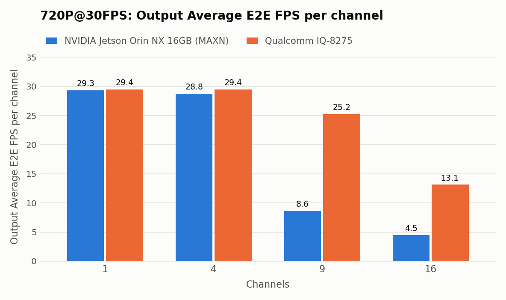
  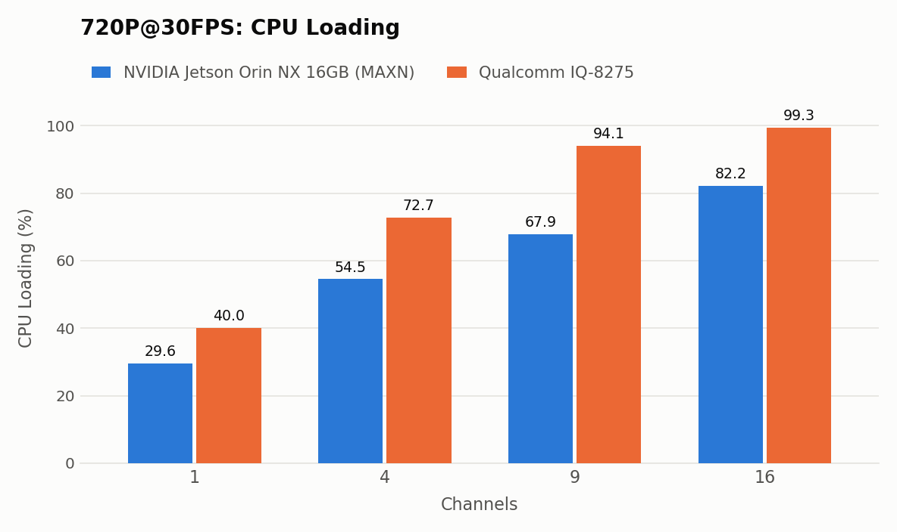
  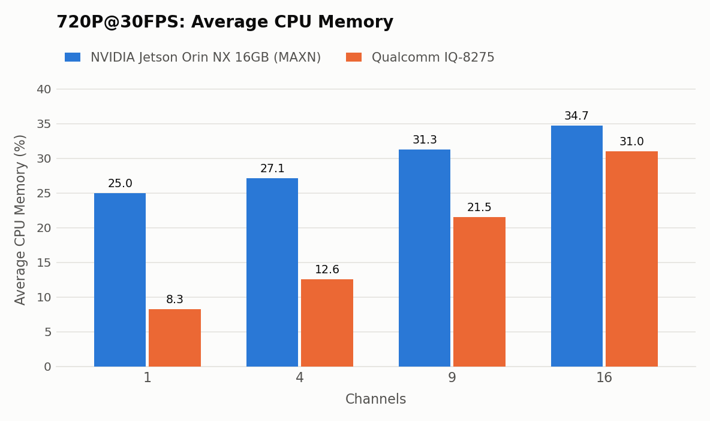
</p>

### 1080P@30FPS

| **Platform** | **Channels** | **Cores** | **Warm-up (s)** | **Power mode** | **CPU loading (%)** | **Average CPU memory (%)** | **Power (W)** | **FPS/Watt** | **Output average E2E FPS/channel** | **P95 (E2E FPS)** | **P75 (E2E FPS)** | **P50 (E2E FPS)** | **P25 (E2E FPS)** |
|:---|:---:|:---:|:---:|:---:|:---:|:---:|:---:|:---:|:---:|:---:|:---:|:---:|:---:|
| **IQ-8275** | 1 | 8 | 300 | Normal | 40.1 | 8.4 | 8.72 | 3.37 | 29.38 | 39.55 | 33.09 | 29.96 | 27.49 |
| **IQ-8275** | 4 | 8 | 300 | Normal | 86.1 | 15.1 | 12.22 | 8.53 | 26.05 | 83.90 | 39.64 | 26.73 | 20.25 |
| **IQ-8275** | 9 | 8 | 300 | Normal | 99.4 | 28.9 | 12.62 | 7.33 | 10.28 | 50.03 | 23.67 | 13.58 | 7.88 |
| **IQ-8275** | 16 | 8 | 300 | Normal | 99.6 | 40.5 | 13.04 | 9.10 | 7.42 | 32.76 | 14.23 | 8.67 | 5.76 |
| **NVIDIA Jetson Orin NX 16GB** | 1 | 8 | 300 | MAXN | 24.8 | 21.9 | 18.03 | 1.63 | 29.34 | 40.69 | 31.02 | 29.86 | 28.52 |
| **NVIDIA Jetson Orin NX 16GB** | 4 | 8 | 300 | MAXN | 62.5 | 25.5 | 29.55 | 3.66 | 27.04 | 61.49 | 36.19 | 28.56 | 23.01 |
| **NVIDIA Jetson Orin NX 16GB** | 9 | 8 | 300 | MAXN | 82.8 | 30.8 | 30.44 | 2.32 | 7.86 | 14.66 | 9.61 | 7.98 | 6.84 |
| **NVIDIA Jetson Orin NX 16GB** | 16 | 8 | 300 | MAXN | 94.4 | 39.5 | 31.43 | 1.93 | 3.79 | 5.22 | 4.37 | 3.90 | 3.47 |

<p align="center">
  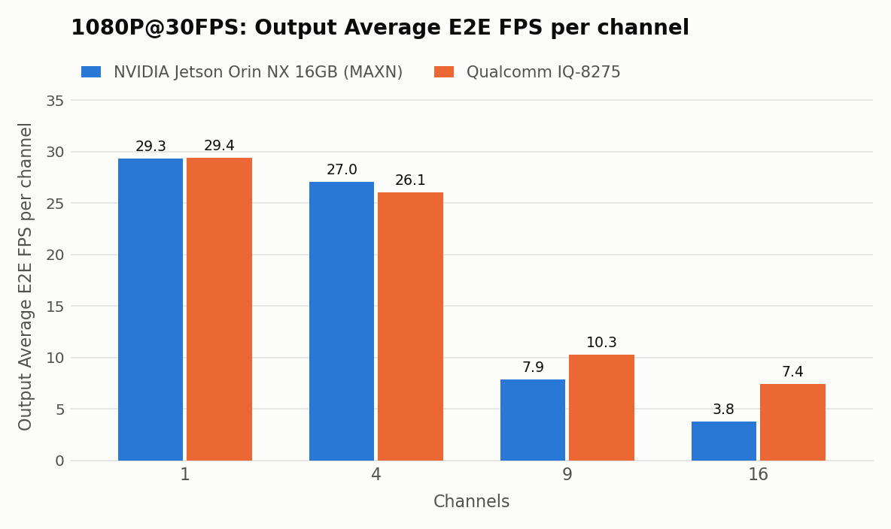
  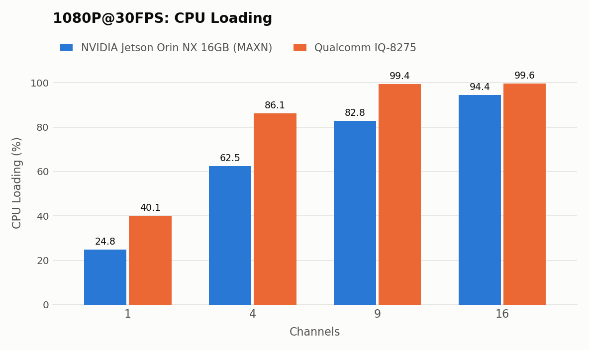
  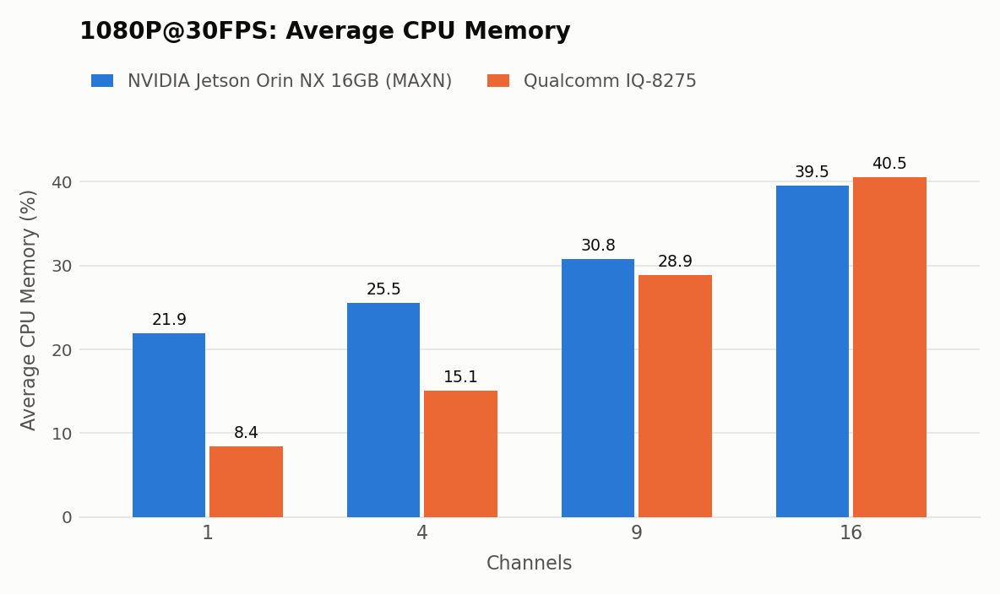
</p>

### 2K@30FPS

| **Platform** | **Channels** | **Cores** | **Warm-up (s)** | **Power mode** | **CPU loading (%)** | **Average CPU memory (%)** | **Power (W)** | **FPS/Watt** | **Output average E2E FPS/channel** | **P95 (E2E FPS)** | **P75 (E2E FPS)** | **P50 (E2E FPS)** | **P25 (E2E FPS)** |
|:---|:---:|:---:|:---:|:---:|:---:|:---:|:---:|:---:|:---:|:---:|:---:|:---:|:---:|
| **IQ-8275** | 1 | 8 | 300 | Normal | 48.9 | 11.1 | 9.54 | 2.99 | 28.49 | 69.06 | 37.58 | 29.67 | 23.93 |
| **IQ-8275** | 4 | 8 | 300 | Normal | 95.3 | 21.6 | 12.70 | 5.64 | 17.92 | 65.45 | 35.26 | 22.17 | 13.30 |
| **IQ-8275** | 9 | 8 | 300 | Normal | 99.3 | 36.5 | 13.02 | 5.61 | 8.11 | 38.64 | 17.32 | 10.23 | 6.19 |
| **NVIDIA Jetson Orin NX 16GB** | 1 | 8 | 300 | MAXN | 36.2 | 26.0 | 19.14 | 1.53 | 29.31 | 51.73 | 34.90 | 29.75 | 25.86 |
| **NVIDIA Jetson Orin NX 16GB** | 4 | 8 | 300 | MAXN | 71.9 | 31.5 | 30.66 | 3.17 | 24.33 | 60.97 | 34.78 | 26.13 | 20.09 |
| **NVIDIA Jetson Orin NX 16GB** | 9 | 8 | 300 | MAXN | 91.5 | 41.5 | 31.55 | 2.10 | 7.37 | 13.85 | 9.20 | 7.59 | 6.35 |

<p align="center">
  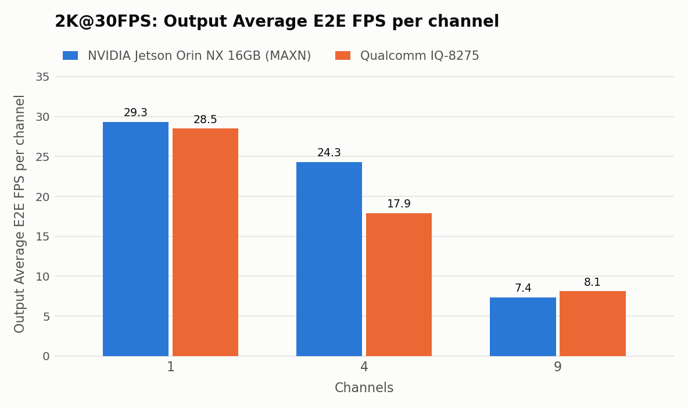
  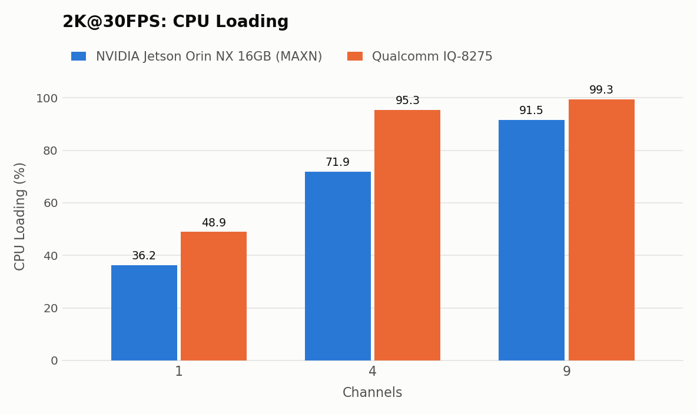
  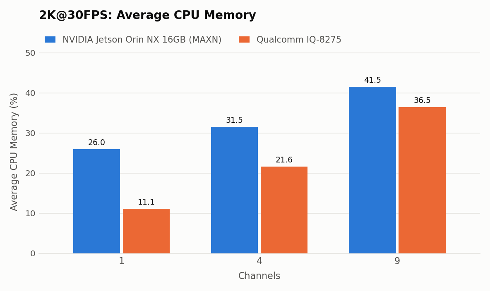
</p>

### 4K@30FPS

| **Platform** | **Channels** | **Cores** | **Warm-up (s)** | **Power mode** | **CPU loading (%)** | **Average CPU memory (%)** | **Power (W)** | **FPS/Watt** | **Output average E2E FPS/channel** | **P95 (E2E FPS)** | **P75 (E2E FPS)** | **P50 (E2E FPS)** | **P25 (E2E FPS)** |
|:---|:---:|:---:|:---:|:---:|:---:|:---:|:---:|:---:|:---:|:---:|:---:|:---:|:---:|
| **IQ-8275** | 1 | 8 | 300 | Normal | 45.7 | 13.8 | 10.05 | 1.89 | 18.97 | 33.46 | 21.71 | 19.17 | 17.31 |
| **IQ-8275** | 4 | 8 | 300 | Normal | 97.0 | 36.0 | 12.67 | 3.37 | 10.68 | 35.18 | 19.77 | 13.06 | 8.52 |
| **NVIDIA Jetson Orin NX 16GB** | 1 | 8 | 300 | MAXN | 29.0 | 28.6 | 19.55 | 1.12 | 21.83 | 29.43 | 24.14 | 22.34 | 20.72 |
| **NVIDIA Jetson Orin NX 16GB** | 4 | 8 | 300 | MAXN | 78.2 | 42.0 | 30.02 | 2.44 | 18.32 | 37.03 | 23.87 | 19.14 | 15.63 |

<p align="center">
  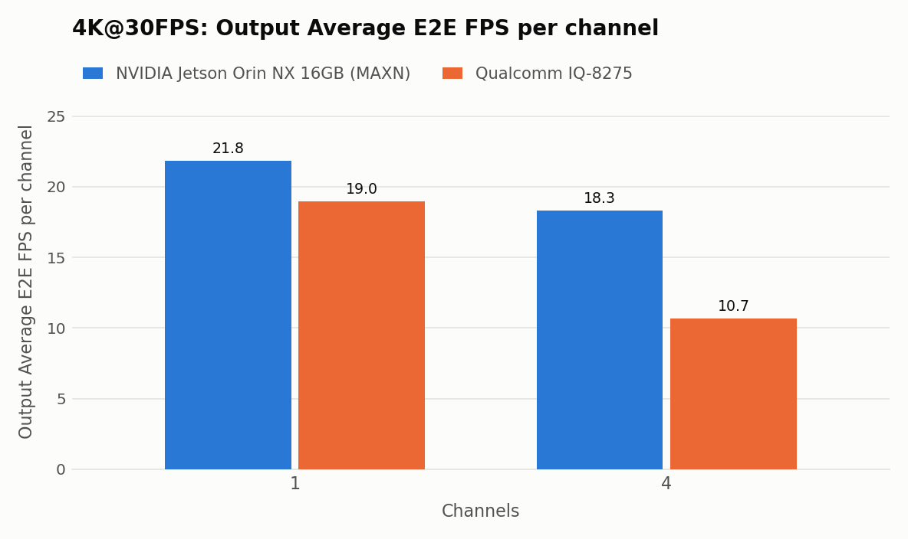
  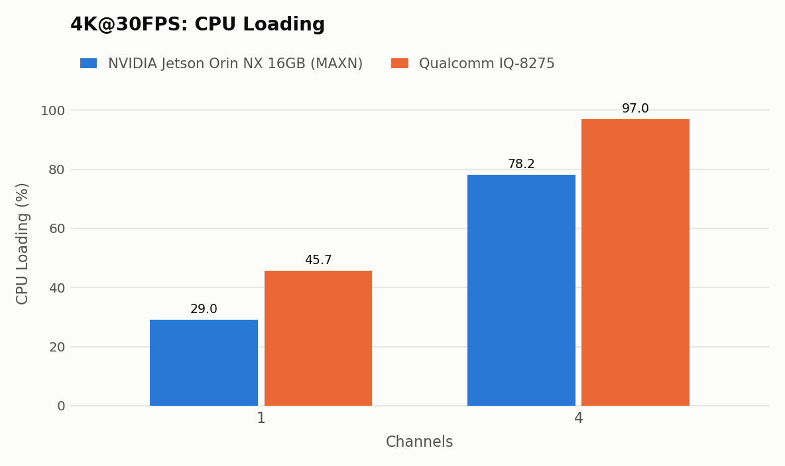
  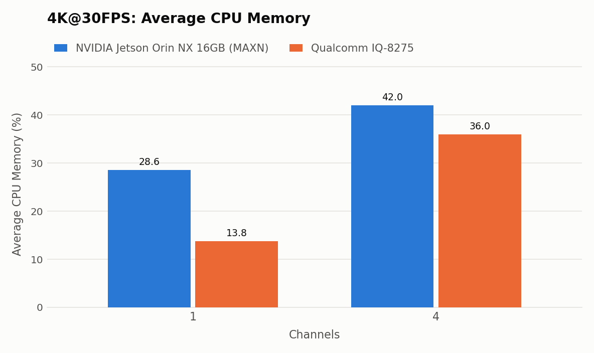
</p>

### Observations

- In the multi-channel cases at 720p and 1080p, the IQ-8275 delivers a higher per-channel FPS than the Jetson Orin NX. At 720p, the 9- and 16-channel cases reach about 25.2 and 13.1 FPS, and at 1080p, about 10.3 and 7.4 FPS.
- The IQ-8275 draws up to 13.9 W over the whole test range, while the Jetson Orin NX draws up to 31.6 W.
- The Jetson Orin NX has 8× Cortex-A78AE cores, and the IQ-8275 has 4× Cortex-A78C + 4× Cortex-A55 cores. The four efficiency cores of the IQ-8275 reach high utilization first, so its overall CPU loading is higher than that of the Jetson Orin NX.

## Conclusion

Both platforms follow the same pattern: per-channel FPS stays near the source rate at low channel counts, then drops as the number of channels increases. Because the CPU of the IQ-8275 is less capable (four of its eight cores are efficiency cores), its per-channel FPS is lower at high resolutions (4K, and 2K with 4 channels). But in the multi-channel cases, it still performs at a good level: at 720p, 9 channels keep 25.2 FPS and 16 channels reach 13.1 FPS, and at 1080p, 9 and 16 channels reach 10.3 and 7.4 FPS, with a lower power consumption.

## How to Use

Below is an overview of how we conduct platform benchmark testing.

### IQ-8275 procedure

1. Install iQ-Studio:

   ```bash
   git clone https://github.com/InnoIPA/iQ-Studio.git
   cd iQ-Studio
   ./install.sh
   ```

2. From the repository root, change to the benchmark directory:

   ```bash
   cd benchmarks/iqs-streampipe-iq8
   ```

3. Edit `config.json` so that the `streams` array contains 1, 4, 9, or 16 entries, depending on
   the channel count being tested. The file contains 9 streams of the YOLO26n model and the
   1080p videos that come with the Docker image.

4. Run the benchmark script with the Qualcomm platform selected:

   ```bash
   ./scripts/auto_benchmark.sh \
       --platform qcom \
       --test_time 420 \
       --warmup_time 300 \
       --output ./logs/qcom_9ch.txt
   ```

   On the first run, `iqs-launcher` pulls the `iqs-streampipe` Docker image, so the board needs
   network access.

   The results are saved in the file given by `--output`. The file starts with the test settings
   (channels, video, warm-up, and test time), followed by the average CPU loading and memory usage,
   and the inference time and FPS tables. Use a different file name for each run, because the file
   is overwritten.

### NVIDIA Jetson Orin NX 16GB procedure

1. Go to the benchmark directory of the iQ-Studio repository and download the archive:

   ```bash
   cd benchmarks/iqs-streampipe-iq8
   wget https://github.com/InnoIPA/iQ-Studio/releases/download/v0.0.13/benchmark_orinnx_sources.tar.gz
   ```

2. In the same directory, extract the NVIDIA benchmark archive and check its contents:

   ```bash
   tar xzf benchmark_orinnx_sources.tar.gz --strip-components=1
   ls -1 config_nv.json nvidia/* videos/*
   ```

   The output should list these files:

   ```text
   config_nv.json            # stream configuration template
   nvidia/model_int8.engine  # TensorRT engine
   nvidia/streampipe_nv      # streampipe executable for the NVIDIA platform
   videos/japan_walk.mp4     # included 1080p video
   ```

3. Set the power mode to MAXN and check it:

   ```bash
   sudo nvpmodel -m 0
   nvpmodel -q
   ```

   The output should be:

   ```text
   NV Power Mode: MAXN
   0
   ```

4. Install the Python virtual environment package if it is missing. The script uses it to keep its Python packages separate from the system (the first run also downloads them, so it needs network access):

   ```bash
   sudo apt install python3-venv
   ```

5. From a desktop session on the Jetson, run the benchmark script with the NVIDIA platform selected:

   ```bash
   ./scripts/auto_benchmark.sh \
       --platform nv \
       --channels 9 \
       --test_time 420 \
       --warmup_time 300 \
       --output ./logs/nv_1080p_9ch.txt \
       --video <your video path>   # replace with the path of your own video
   ```

   Without `--channels` and `--video`, it runs `config_nv.json` as is, which is 1 channel of
   `videos/japan_walk.mp4`.

   The results are saved in the file given by `--output`. The file starts with the test settings (channels, video, warm-up, and test time), followed by the average CPU loading and memory usage, and the inference time and FPS tables. Use a different file name for each run, because the file is overwritten.
