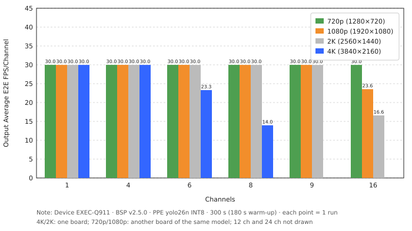
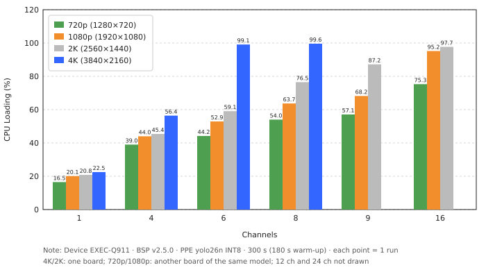
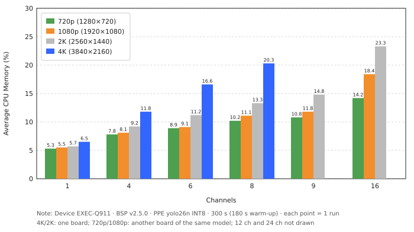
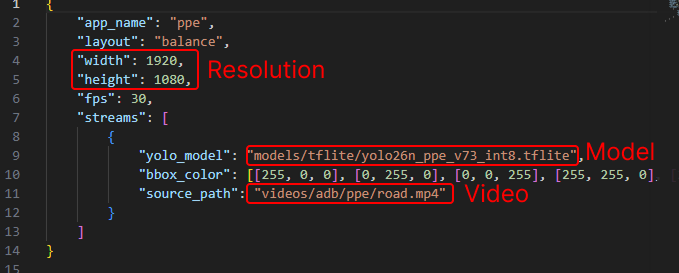

<!--
 Copyright (c) 2025 Innodisk Corp.

 This software is released under the MIT License.
 https://opensource.org/licenses/MIT
-->

# Multi-stream inference scaling on EXEC-Q911 (QCS9075) across video resolutions

This topic describes a multi-stream inference benchmark on the EXEC-Q911 at
720p, 1080p, 2K, and 4K. The purpose is to observe how many channels the
platform sustains in real time at each resolution, and what limits it as the
channel count increases. The results are not intended to be a general hardware
performance ranking.

- Application: [iQS-QVADK](../../tutorials/applications/iqs-qvadk/README.md) v3.0.0 (GStreamer hardware decode → inference → drawing → compositor display)
- Task: object detection with an INT8 model
- Input: 720p, 1080p, 2K, and 4K, 30 FPS H.264 video streams
- Platform: EXEC-Q911 (Qualcomm Dragonwing QCS9075), BSP v2.5.0
- Metrics:
  - Output average end-to-end FPS per channel
  - Average CPU loading (%)
  - Average CPU memory usage (%)
  - System power (W) and FPS per watt

## Hardware

| **Platform**        | **EXEC-Q911**                                |
|:--------------------|:---------------------------------------------|
| **SoM / SoC**       | Qualcomm Dragonwing QCS9075                  |
| **Power plan**      | Normal                                       |
| **Processor cores** | 8                                            |
| **AI accelerator**  | NPU                                          |
| **AI runtime**      | TFLite 2.16.1 (QNN 2.47.0)                   |
| **AI performance**  | 100 TOPS                                     |
| **Linux kernel**    | 6.18.30-01953-g5086fd78561b-dirty (PREEMPT)  |

## AI model

| **Architecture** | **Numerical precision** | **Parameters** | **Input size** | **Model size** | **Model format** | **Dataset**  | **Classes** |
|:-----------------|:------------------------|:---------------|:---------------|:---------------|:-----------------|:-------------|:------------|
| YOLO26n          | INT8                    | 2.4 M          | 640 × 640      | 2.60 MiB       | TFLite           | Innodisk PPE | 5           |

## Videos

| **File type** | **Resolution** | **Frame rate** | **Codec** | **Bitrate** | **File size** | **Length** |
|:--------------|:---------------|:---------------|:----------|:------------|:--------------|:-----------|
| MP4           | 720p           | 30 FPS         | H.264     | 15.8 Mbps   | 56.4 MiB      | 30 s       |
| MP4           | 1080p          | 30 FPS         | H.264     | 15.8 Mbps   | 56.4 MiB      | 30 s       |
| MP4           | 2K             | 30 FPS         | H.264     | 15.5 Mbps   | 55.5 MiB      | 30 s       |
| MP4           | 4K             | 30 FPS         | H.264     | 15.4 Mbps   | 55.2 MiB      | 30 s       |

The four videos were made from one licensed stock video from
[Envato](https://app.envato.com/stock-video/5a08c377-3935-48d8-b0e5-741d82db817e),
and they are not distributed with iQ-Studio. To reproduce the results, license
a video and prepare your own copies at each resolution.

The four videos have almost the same bitrate, so only the resolution differs.
This bitrate is higher than a typical 720p to 2K camera stream (about 2–8 Mbps),
so the results show the load at equal bitrate and may not match a real camera
deployment.

## Results

### Measurement summary

Each channel count was run once for 300 seconds with a 180-second warm-up. CPU
and memory are averages over the 120 seconds after warm-up. Power is a single
reading of the whole board at the power adapter.

| **Resolution** | **Channels** | **CPU loading (%)** | **Average CPU memory (%)** | **Output average E2E FPS/channel** | **Power (W)** | **FPS/Watt** |
|:---------------|:------------:|:-------------------:|:--------------------------:|:----------------------------------:|:-------------:|:------------:|
| **720p** | 1 | 16.5 | 5.3 | 29.99 | 10.1 | 2.97 |
| **720p** | 4 | 39.0 | 7.8 | 29.99 | 13.0 | 9.23 |
| **720p** | 6 | 44.2 | 8.9 | 29.99 | 15.8 | 11.39 |
| **720p** | 8 | 54.0 | 10.2 | 29.99 | 18.3 | 13.11 |
| **720p** | 9 | 57.1 | 10.8 | 29.99 | 19.0 | 14.21 |
| **720p** | 12 | 66.3 | 11.7 | 29.98 | 20.9 | 17.21 |
| **720p** | 16 | 75.3 | 14.2 | 29.98 | 23.2 | 20.68 |
| **1080p** | 1 | 20.1 | 5.5 | 29.98 | 10.4 | 2.88 |
| **1080p** | 4 | 44.0 | 8.1 | 29.99 | 14.9 | 8.05 |
| **1080p** | 6 | 52.9 | 9.1 | 29.99 | 16.9 | 10.65 |
| **1080p** | 8 | 63.7 | 11.1 | 29.98 | 20.2 | 11.87 |
| **1080p** | 9 | 68.2 | 11.8 | 29.98 | 21.2 | 12.73 |
| **1080p** | 12 | 84.6 | 13.9 | 29.97 | 23.9 | 15.05 |
| **1080p** | 16 | 95.2 | 18.4 | 23.55 | 24.8 | 15.19 |
| **1080p** | 24 | 94.9 | 24.2 | 15.54 | 25.3 | 14.74 |
| **2K** | 1 | 20.8 | 5.7 | 29.98 | 10.8 | 2.78 |
| **2K** | 4 | 45.4 | 9.2 | 29.99 | 16.4 | 7.31 |
| **2K** | 6 | 59.1 | 11.2 | 29.98 | 23.1 | 7.79 |
| **2K** | 8 | 76.5 | 13.3 | 29.98 | 22.8 | 10.52 |
| **2K** | 9 | 87.2 | 14.8 | 29.97 | 24.5 | 11.01 |
| **2K** | 12 | 97.8 | 19.1 | 21.75 | 25.1 | 10.40 |
| **2K** | 16 | 97.7 | 23.3 | 16.59 | 25.2 | 10.53 |
| **4K** | 1 | 22.5 | 6.5 | 29.98 | 11.7 | 2.56 |
| **4K** | 4 | 56.4 | 11.8 | 29.98 | 20.7 | 5.79 |
| **4K** | 6 | 99.1 | 16.6 | 23.30 | 24.6 | 5.68 |
| **4K** | 8 | 99.6 | 20.3 | 13.97 | 24.8 | 4.51 |

`FPS/Watt = (FPS per channel ÷ power) × channels`. 4K stops at 8 channels
(decoder limit). For channel counts that are not
listed, see [Known issues](#known-issues).

<p align="center">
  
  
  
</p>

- The FPS plot (left) shows every resolution holding about 30 FPS per channel
  at low channel counts, then dropping once the CPU saturates: from 6 channels
  at 4K, 12 channels at 2K, and 16 channels at 1080p. 720p still holds 30 FPS
  at 16 channels.

- The CPU loading plot (middle) shows the FPS drop lining up with CPU loading
  reaching about 95–99%. NPU utilization stayed below about 50% in every test
  (for example 4K 8 channels about 14%, 720p 16 channels about 48%), so the CPU,
  not the NPU, is the bottleneck.

- The CPU memory plot (right) shows memory usage rising with channel count but
  staying moderate. It is the system-wide RAM usage, not NPU memory.

## Conclusion

On EXEC-Q911 with this workload, near real-time FPS per channel is sustained up
to 16 channels at 720p, 12 channels at 1080p, 9 channels at 2K, and 4 channels
at 4K. Beyond that, the CPU saturates and per-channel FPS drops. Lower
resolutions allow more channels, but the limit is not set by pixel count alone.

### Notes

- **Uptime:** when the CPU is saturated, results get slower the longer the
  board has been up (about 11–20% lower after two hours, for example 1080p 16
  channels: 22–24 FPS shortly after boot, about 19 FPS after two hours). Runs
  that are not CPU-limited are not affected. The cause is unknown, so record
  the uptime when comparing results.
- **Boards:** 4K and 2K were measured on one board and 720p and 1080p on
  another of the same model. Board-to-board variation was not measured.
- **Single run:** each point was run once, and power is a manual reading, so
  small differences are not meaningful.

### Known issues

The following issues were observed with iQS-QVADK v3.0.0 on BSP v2.5.0.

- 720p at 24 and 32 channels and 1080p at 32 channels cannot run (NPU graph
  memory allocation fails).
- 1080p at 24 channels and 2K at 16 channels fail intermittently.
- `streampipe` crashes once at the end of each run, after the report is
  printed. The results are not affected.

These issues are under investigation and will be re-tested after fixes.

## How to Use

Below is an overview of how we conduct this benchmark on EXEC-Q911. The
application runs in a Docker container.

1. Install iQ-Studio

   ```bash
   git clone https://github.com/InnoIPA/iQ-Studio.git
   cd iQ-Studio
   ./install.sh
   ```

   The iQS-QVADK Docker image is not included in the BSP. Pull it first:

   ```bash
   docker pull innodiskorg/iqs-qvadk:latest
   ```

2. From the repository root on EXEC-Q911, change to the benchmark directory:

   ```bash
   cd benchmarks/multistream
   ls
   ```

   You should see `config.json` in this directory:

   ```text
   README.md  config.json  fig
   ```

   [config.json](./config.json) is the config used in the next step. `iqs-launcher`
   shares the current directory with the container as `/workspace`, so the
   application reads it as `/workspace/config.json`. The default config runs 1
   channel of the 1080p demo video in the image, so you can run the next step as
   it is. To change the video, the model, or the channel count, see
   [How to change the config](#how-to-change-the-config).

3. Run the benchmark for 300 seconds with a 180-second warm-up. Start it from an
   SSH session, because programs started from `adb` or system services are
   limited to CPU cores 0–3, which lowers the results:

   ```bash
   timeout 300 iqs-launcher --autotag iqs-qvadk \
       --other "-c /workspace/config.json -b --warmup_time 180"
   ```

   The application prints the inference time and FPS report when it stops.

4. Open a second SSH session. When the application has been running for 180
   seconds, measure CPU and memory for 120 seconds. Run this from the directory
   where you ran `git clone`:

   ```bash
   cd iQ-Studio/benchmarks/multistream
   timeout 120 python3 ../iqs-streampipe/scripts/system_monitor.py
   ```

5. (Optional) Around 250 seconds, read the power meter. The platform's power
   adapter is plugged into a digital power meter (DDSC-728), so the meter shows
   the power of the whole system.

### How to change the config

Open `config.json` in `benchmarks/multistream/` and edit it:

```bash
vi config.json
```

<br />
<div align="center"></div>
<br />

- **Video:** the default `source_path` is `videos/adb/ppe/road.mp4`, the 1080p
  demo video in the image. To use your own video, first copy the file to the
  `benchmarks/multistream/` directory on the platform. For example, run this on
  your PC:

  ```bash
  scp 01_720.mp4 root@<platform IP>:~/iQ-Studio/benchmarks/multistream/
  ```

  Then set `source_path` to `/workspace/<file name>`, for example
  `/workspace/01_720.mp4`. `/workspace` is the `benchmarks/multistream/`
  directory as seen from inside the container, so the file must be in that
  directory. Also change `width` and `height` (**Resolution** in
  the figure) to the resolution of the video:

  | Resolution | `width` | `height` |
  |:-----------|:--------|:---------|
  | 720p       | 1280    | 720      |
  | 1080p (default) | 1920 | 1080   |
  | 2K         | 2560    | 1440     |
  | 4K         | 3840    | 2160     |

- **Model:** the default `yolo_model` (**Model** in the figure) is `models/tflite/yolo26n_ppe_v73_int8.tflite`,
  which is in the image. To use your own model, copy the file to the
  `benchmarks/multistream/` directory on the platform in the same way, and set
  `yolo_model` to `/workspace/<file name>`.
- **Channel count:** the `streams` array has 1 entry (the `{ ... }` block in
  the figure), which is 1 channel. Copy the whole block and paste it after
  itself, separated by a comma, until the array has the channel count you want
  to test (for example 4, 8, or 16 entries). Every channel uses the same video.

> Note: The only video we provide is the 1080p demo video in the image. The
> videos used in this report are not distributed, so you need to prepare the
> videos for the other resolutions yourself. Results with other videos differ
> from this report; to compare, use a 30-second H.264 video at about 15.5 Mbps
> and 30 FPS.
