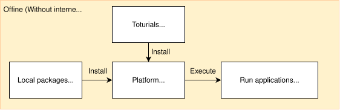

<!--
 Copyright (c) 2025 Innodisk Corp.

 This software is released under the MIT License.
 https://opensource.org/licenses/MIT
-->

# How to Use iqs-launcher

`iqs-launcher` is the execution entry point for every application shipped with iQ-Studio. It locates the Docker image for the application and runs it. It supports both online mode (pull from Docker Hub) and offline mode (load pre-staged files).

This page covers both modes side by side. For a single end-to-end demo command, see the [Quick Start](../README.md#getting-started) in the entry page.

## Introduction

`iqs-launcher` consists of three pieces:

- `iqs-launcher.sh` — the shell entry point installed by `install.sh` into your `PATH`.
- `launcher.py` — the dispatcher that parses CLI flags and routes to a module.
- `mod/` — module-level logic: `mod/autotag.py` handles Docker images, `mod/run.py` executes application scripts, and `mod/utils.py` provides helper functions such as autotag parsing.

The public command surface is:

```bash
iqs-launcher --autotag <app_name>[:<version>]    # Docker image: pull / load / run
iqs-launcher --other <command>                   # Additional flags forwarded to the application
```

`iqs-launcher` does not check the BSP version. `install.sh` checks it once at installation, so choose the iQ-Studio version that matches your BSP as described in [Install iQ-Studio](../README.md#install-iq-studio).

## Online Mode

Online mode is the default path. With internet access on the platform, `iqs-launcher --autotag` pulls the matching Docker image directly from Docker Hub.

<br />
<div align="center"></div>
<br />

Common online-mode commands used in the tutorials:

```bash
iqs-launcher --autotag iqs-vlm-demo
iqs-launcher --autotag iqs-streampipe
iqs-launcher --autotag iqs-yolov10n
```

To pin a specific version, append `:<version>` to the autotag value, for example `iqs-launcher --autotag iqs-yolov10n:v0.1.0`. To pass extra flags to the underlying application, use `--other`, for example `iqs-launcher --autotag iqs-streampipe --other "-c config.json"`.

## Offline Mode

Use offline mode when the platform has no internet access. You pre-stage the Docker image (`.tar`) on a host PC, transfer it to the platform, and `iqs-launcher` loads it locally.

<br />
<div align="center"></div>
<br />

### Step 1: Download the Package on a Host PC

> Notice: This step requires internet access on the host PC. If you cannot access Docker Hub, contact Innodisk to obtain the `.tar`.

1. Install [skopeo](https://github.com/containers/skopeo). On an x86 Ubuntu 24.04 host:

    ```bash
    sudo apt-get -y update
    sudo apt-get -y install skopeo
    ```

    For other host systems, refer to the official [skopeo installation guide](https://github.com/containers/skopeo/blob/main/install.md).

2. Use `skopeo copy` to download the image as a `.tar` archive.

    Search Docker Hub for the image you need. Enter `innodiskorg/<application name>` at position 1, then pick the version at position 2.

    

    Download the image with the command below.

    Usage:

    ```bash
    skopeo copy \
    docker://docker.io/innodiskorg/<docker image name>:<version>\
    "docker-archive:<docker image name>.tar:innodiskorg/<docker image name>:<version>"
    ```

    Example for `iqs-vlm-demo` version `0.0.1`:

    ```bash
    skopeo copy \
    docker://docker.io/innodiskorg/iqs-vlm-demo:0.0.1 \
    "docker-archive:iqs-vlm-demo.tar:innodiskorg/iqs-vlm-demo:0.0.1"
    ```

    The result is a `.tar` file ready to transfer to the platform.

### Step 2: Transfer the Package to the Platform

1. Prepare a USB flash drive.
2. Copy the `.tar` to the USB drive, then insert it into the platform.
3. Locate the USB device on the platform:

    ```bash
    # on your Qualcomm platform
    lsblk
    ```

4. Sample output (your hardware layout may differ):

    ```bash
    |-sde53 259:37   0     4K  0 part
    `-sde54 259:38   0     1M  0 part
    sdf       8:80   0   200M  0 disk
    sdg       8:96   0     1G  0 disk
    sdh       8:112  0     1G  0 disk
    sdi       8:128  1  14.5G  0 disk
    `-sdi1    8:129  1  14.5G  0 part <- Your USB device
    ```

5. Create a mount point and mount the USB drive (the example assumes you are in the home directory):

    ```bash
    mkdir workspace/usb/
    mount /dev/sdi1 workspace/usb/
    ```

6. Copy the `.tar` into the iQ-Studio binaries directory:

    ```bash
    cp workspace/usb/<docker image>.tar /path/to/iQ-Studio/binaries/docker-images/
    ```

7. Verify the package is in the correct location.

    The `.tar` must be under `iQ-Studio/binaries/docker-images/`:

    ```text
    iQ-Studio/
    └── binaries/
        └── docker-images/
            └── iqs-vlm-demo.tar  <-- your .tar
    ```

### Step 3: Launch the Application

Run the same `iqs-launcher` command as in online mode. `iqs-launcher` detects the local `.tar` and loads it directly without contacting Docker Hub. For application-specific usage, see the relevant page under [Applications](../tutorials/applications/README.md).

## Troubleshooting

- **BSP version mismatch**: `install.sh` aborts when the BSP is earlier than v2.5.0. Run `git checkout v0.0.10` in the `iQ-Studio` directory and install again. `iqs-launcher` does not select a version automatically, so make sure the iQ-Studio version matches your BSP (see [Install iQ-Studio](../README.md#install-iq-studio)).
- **`autotag` cannot find an image**: in online mode, verify network access from the platform. In offline mode, confirm the `.tar` is under `binaries/docker-images/` and that the filename matches the autotag value.

## Related

- Applications you can launch with `iqs-launcher`: [Applications](../tutorials/applications/README.md).
- Customizing an application after running it: [SDKs](../tutorials/sdks/README.md).
- The `mod/` source code is in the repository root under [mod/](../mod/).
