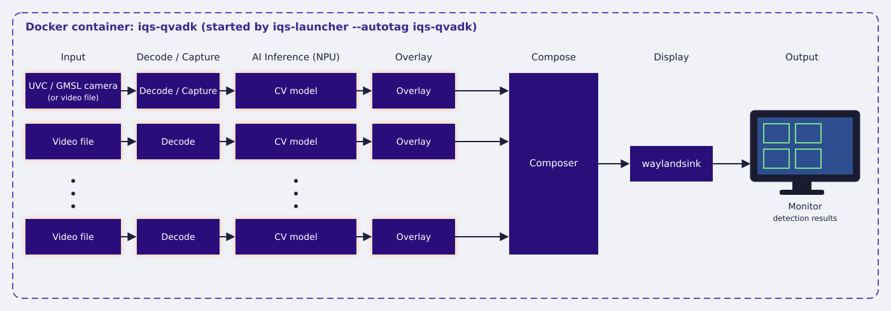
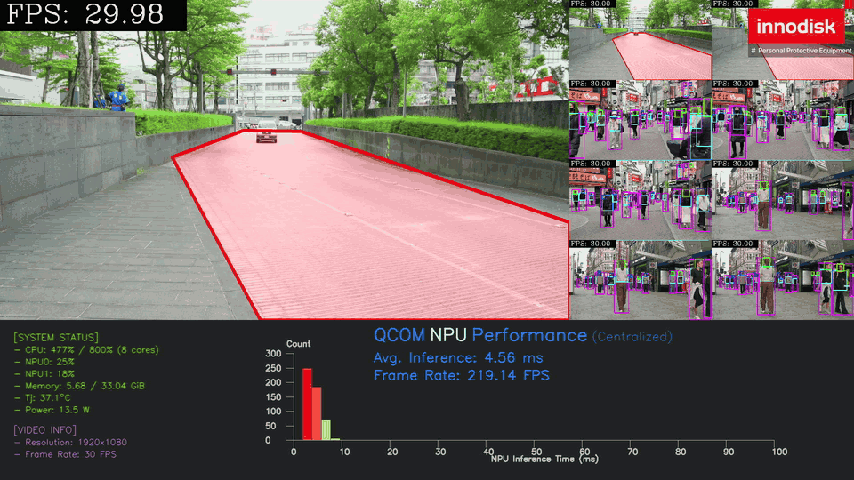

<!--
 Copyright (c) 2025 Innodisk Corp.
 
 This software is released under the MIT License.
 https://opensource.org/licenses/MIT
-->

# iQS-QVADK

QVADK is a high-throughput, multi-stream AI video pipeline built for vertical applications. It takes many 1080p video channels at once and runs several AI models on every channel, all accelerated on the Qualcomm NPU of a single Dragonwing device, so a single box can monitor many cameras in real time.

iqs-qvadk runs two applications. The demo below runs the default **PPE (Personal Protective Equipment) detection**; you can also switch to [**Defect detection**](../../sdks/iqs-qvadk/README.md#defect-detection), which detects defects on production line video.

Other applications, such as PPE with a camera and DMS (Driver Monitoring System), are shown on the [preview page](../../sdks/iqs-qvadk/README.md#other-applications-preview-only) for demonstration only.

>Note: The demo GIF may take some time to load. If it does not appear immediately, please wait.

<br />
<div align="center"></div>
<br />

<br />
<div align="center"></div>
<br />

# How to Deploy

## Supported Versions

Pick the iQ-Studio version that matches your platform:

| Your platform | iQ-Studio version |
| :--- | :--- |
| BSP 2.5.x (QLI 2.0) | Latest (`main`) |

- **Check BSP:** `cat /etc/innodisk/BSP-version`
- **Check QLI:** `uname -a`, then look for the `qli-<version>` field.

## What You Need?

1. At least 10 GB of free disk space
2. A monitor

## How to Start?

```bash
git clone https://github.com/InnoIPA/iQ-Studio.git
cd iQ-Studio
./install.sh
```

# How to Use

1. Use iqs-launcher and autotag tools to automatically pull or build a compatible docker image.

    ```bash
    iqs-launcher --autotag iqs-qvadk
    ```

2. You will see the PPE detection result on the screen.
    >Note: The demo GIF may take some time to load. If it does not appear immediately, please wait.

    

# Switch to Other Applications

For advanced features and usage examples, visit this [page](../../sdks/iqs-qvadk/README.md) to learn more.
