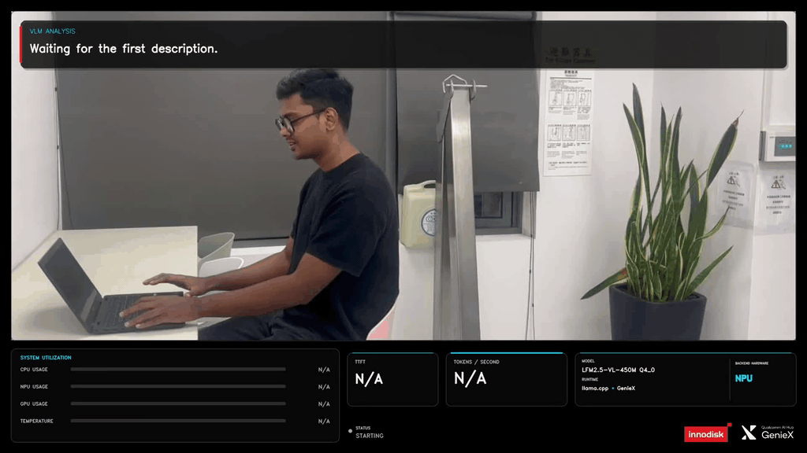

<!--
 Copyright (c) 2025 Innodisk Corp.
 
 This software is released under the MIT License.
 https://opensource.org/licenses/MIT
-->

# iQS-VLM

This demo runs a vision-language model (VLM) on the platform in real time,
powered by [GenieX](https://github.com/qualcomm/GenieX). It reads a live video
stream from a UVC Camera, asks the model to describe what it sees, and shows the
description on a fullscreen dashboard on the monitor.




## Supported Models

The demo ships with two models. Everything runs inside one container image, so
nothing has to be downloaded or installed separately.

| Model | Runtime | Backend |
| :--- | :--- | :--- |
| **Qwen3-VL-4B** (default) | GenieX-Qairt | NPU |
| **LFM2.5-VL-450M** | GenieX-llama.cpp | NPU, CPU, GPU, Hybrid |

The runtime selects the model: `GenieX-Qairt` runs Qwen3-VL-4B, and
`GenieX-llama.cpp` runs LFM2.5-VL-450M.

Both runtimes are powered by [GenieX](https://github.com/qualcomm/GenieX) **v0.9.3**.


# How to Deploy

## Supported Versions

Pick the iQ-Studio version that matches your platform:

| Your platform | iQ-Studio version | VLM demo |
| :--- | :--- | :--- |
| BSP 2.5.x (QLI 2.0) | Latest (`main`) | GenieX-based (Qwen3-VL-4B, LFM2.5-VL-450M) |
| BSP 2.3.x (QLI 1.8) | Tag `v0.0.10` or earlier | OGenie-based (LLaVA-1.5-7B) |

- **Check BSP:** `cat /etc/innodisk/BSP-version`
- **Check QLI:** `uname -a`, then look for the `qli-<version>` field.

> Note: On BSP 2.3.x, run `git checkout v0.0.10` in the `iQ-Studio` directory before `./install.sh`. These older versions use the OGenie-based VLM demo, so follow the README in that checkout instead of this page. To return to the latest version, run `git checkout main`.

## What do you need?
1. A platform: [EXMP-Q911](https://www.innodisk.com/en/products/computing/qualcomm-solution/exmp-q911), [EXEC-Q911](https://www.innodisk.com/en/products/computing/qualcomm-solution/exec-q911) or [APEX-A100](https://www.innodisk.com/en/edge-ai-systems/qualcomm-solution/apex-a100)
2. At least 10 GB of free disk space
3. A monitor
4. A UVC camera
    - 1080p/30fps (1920x1080 pixels)
    - MJPEG compression format
    > Note: We have tried this demo with this [USB camera](https://www.innodisk.com/en/products/camera/usb-20/ev2u-ssm1-rlcf).

Please plug both devices—the UVC camera and the monitor—into the platform.

## How to start?

```bash
git clone https://github.com/InnoIPA/iQ-Studio.git
cd iQ-Studio
./install.sh
```

# How to Use

## Run the demo

One command starts the demo with the default model, **Qwen3-VL-4B** on the NPU:

```bash
iqs-launcher --autotag iqs-vlm-demo
```

> Note: The first run downloads the demo image (about 3.8 GB) if it is not
> already on the platform. Later runs start right away.

The dashboard opens on the monitor once the model has loaded.

## Choose a model and backend

Pass the runtime and the backend with `--other`. The runtime selects the model.

**Qwen3-VL-4B** (GenieX-Qairt) runs on the NPU only:

```bash
iqs-launcher --autotag iqs-vlm-demo --other "--runtime GenieX-Qairt --backend NPU"
```

**LFM2.5-VL-450M** (GenieX-llama.cpp) runs on the NPU, CPU, GPU or Hybrid backend.
Pick one:

- NPU

  ```bash
  iqs-launcher --autotag iqs-vlm-demo --other "--runtime GenieX-llama.cpp --backend NPU"
  ```

- CPU

  ```bash
  iqs-launcher --autotag iqs-vlm-demo --other "--runtime GenieX-llama.cpp --backend CPU"
  ```

- GPU

  ```bash
  iqs-launcher --autotag iqs-vlm-demo --other "--runtime GenieX-llama.cpp --backend GPU"
  ```

- Hybrid

  ```bash
  iqs-launcher --autotag iqs-vlm-demo --other "--runtime GenieX-llama.cpp --backend HYBRID"
  ```

> Note: On the GPU and Hybrid backends, the first response takes a few seconds
> longer while the GPU prepares the model.

To switch to another model or backend, stop the demo and start it again.

## Stop the demo

Press `q` in the dashboard window, or `Ctrl+C` in the terminal. The demo shuts
down cleanly and prints:

```text
GenieX VLM Demo stopped and exited cleanly.
```

> **Important:** Always stop the demo with `q` or `Ctrl+C`. Killing the
> container (for example with `docker rm -f`) can leave NPU memory reserved
> until the platform is rebooted.

# Performance

Measured on the NPU with the live camera feed:

| Model | Runtime | Backend | TTFT | Tokens per second |
| :--- | :--- | :--- | :--- | :--- |
| Qwen3-VL-4B | GenieX-Qairt | NPU | ~640 ms | ~14 |
| LFM2.5-VL-450M | GenieX-llama.cpp | NPU | ~390 ms | ~92 |

TTFT (time to first token) is the time from sending a camera frame to the
model until the first word of the description appears.

# Troubleshooting

| Message | What to do |
| :--- | :--- |
| `cannot start: these required host paths are missing:` | Usually the UVC Camera is not plugged in. Reconnect it and start again. |
| `No usable graphical display was found` | Make sure the monitor is connected and the desktop is running. |
| `a container named iqs-vlm-demo already exists` | A previous run did not exit cleanly. Run `docker rm -f iqs-vlm-demo`, then start again. |
| `invalid launch selection: ...` | The runtime and backend do not match. Use the values in [Choose a model and backend](#choose-a-model-and-backend). |
| `model warm-up failed` | NPU memory is still held by an earlier run that was killed. Reboot the platform. |

Logs are saved on the platform in `/var/lib/iqs-vlm-demo/logs`.

# Chat with the Model through Open WebUI

For advanced features and usage examples, visit this [page](../../sdks/iqs-vlm/README.md) to learn more.
