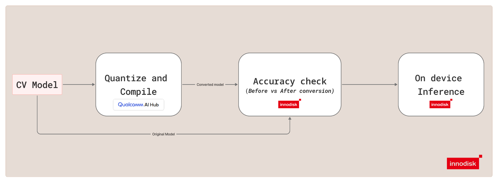
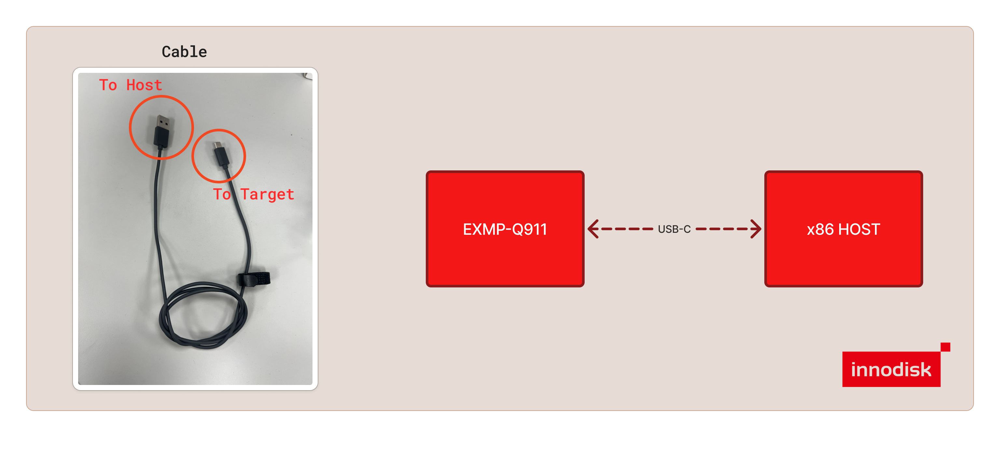
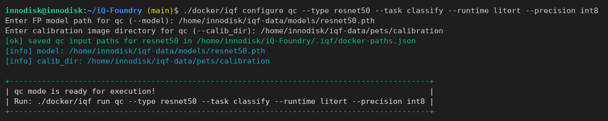
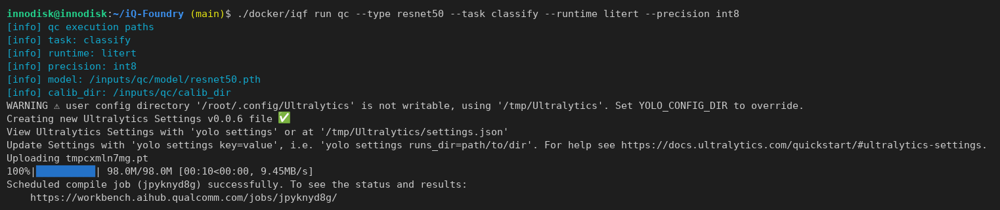
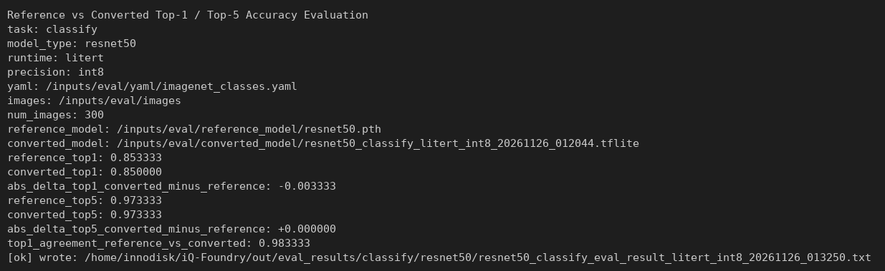
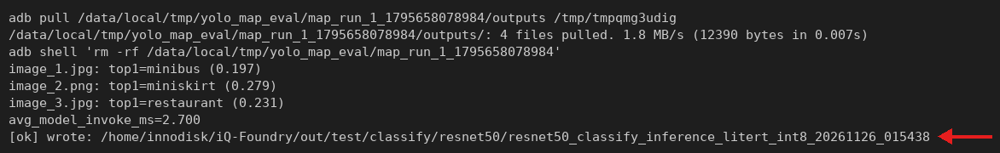

# Model Deploy: How to Convert, Optimize, and Perform Inference with ResNet50 Classification Models

This iQ-Studio tutorial follows the [iQ-Foundry](https://github.com/InnoIPA/iQ-Foundry) ResNet50 image classification workflow for EXMP-Q911 (Qualcomm QCS9075). It covers the default Ubuntu host flow for model preparation, quality assurance, and ADB-based inference through `./docker/iqf`.



## Overview

This guide follows a straightforward end-to-end flow:

1. Quantize and convert the FP32 ResNet50 model into a deployment-ready `.tflite` model with Qualcomm AI Hub.
2. Compare source and converted model quality with `eval` (`top-1` and `top-5` accuracy).
3. Run inference on EXMP-Q911 (Qualcomm QCS9075) through ADB from the Ubuntu host.

The model must be a torchvision `resnet50` with its architecture unchanged. Save it as a state_dict (`.pt` or `.pth`) that outputs raw logits, for example:

```python
torch.save(model.state_dict(), "resnet50.pth")
```

Train it with the ImageNet mean and standard deviation and a 224 x 224 input. Do not add the normalization to the model; `qc` adds it.

## Requirements

| Item | Requirement |
| --- | --- |
| Host OS | x86 Ubuntu 22.04 |
| Target | EXMP-Q911 (Qualcomm QCS9075) |
| Connection | USB-C for ADB-based execution |
| QAI Hub | [Qualcomm AI Hub](https://aihub.qualcomm.com/) API token |

> **Note:** This tutorial follows the Ubuntu host workflow. If you are using Windows, refer to the
> [iQ-Foundry Windows Host Guide](https://github.com/InnoIPA/iQ-Foundry/blob/main/Windows_host.md).

## Step 1. Connect Device

Connect the EXMP-Q911 target to the host with a USB-C cable.



ADB reference: [adb overview](https://developer.android.com/tools/adb). No steps are required from that page for this tutorial.

For more about ADB interaction, see [Interact with the system using adb](../../../starting-guides/iq-9075/yocto.md#interact-with-the-system).

## Step 2. Clone the Repository and Prepare the Host

Clone the iQ-Foundry repository, go to the repository directory, install Docker Engine, and pull the published iQF image:

```bash
git clone https://github.com/InnoIPA/iQ-Foundry.git
cd iQ-Foundry
bash ./docker_install.sh
docker pull innodiskorg/iqf:latest
```

Docker Engine and the published `innodiskorg/iqf:latest` image provide the prepared runtime used by `./docker/iqf` on the Ubuntu host.

## Step 3. Authenticate with Qualcomm AI Hub

Log in to the [Qualcomm AI Hub Workbench](https://aihub.qualcomm.com/).

Navigate to `Account -> Settings -> API Token` to find your unique API token.

Authenticate the host workflow with your API token:

```bash
./qaihub_login.sh --key <YOUR_QAI_HUB_API_KEY>
```

## Step 4. Run the Modes

> Note: The examples below use `resnet50` with `--task classify --runtime litert --precision int8`.

Follow the steps for each mode below to convert the model (qc), evaluate its quality (eval), and deploy ResNet50 image classification (test).

### 1. QC

`qc` converts a torchvision ResNet50 state_dict into a deployment-ready artifact through QAI Hub.

Configure the required paths:

```bash
./docker/iqf configure qc --type resnet50 --task classify --runtime litert --precision int8
```

When prompted, enter the requested model and calibration paths.



Run the mode:

```bash
./docker/iqf run qc --type resnet50 --task classify --runtime litert --precision int8
```

This generates the converted artifact in the output directory.



Output location: `out/model/classify/resnet50/resnet50_classify_litert_int8_<timestamp>.tflite`

### 2. Eval

`eval` compares source versus converted model quality (`top-1` and `top-5` accuracy). The source model runs on the
host, and the converted model runs on EXMP-Q911 (Qualcomm QCS9075) through ADB.

`eval` needs one sub-folder per class in the image folder. The folder names must be written exactly as the class names in the YAML:

```text
validation_images/
├── class_0/
│   ├── image_001.jpg
│   └── ...
├── class_1/
└── ...
```

No annotation file is needed. The report gives the `top-1` and `top-5` accuracy of the source and the converted model.

Configure the required paths:

```bash
./docker/iqf configure eval --type resnet50 --task classify --runtime litert --precision int8
```

When prompted, enter the requested image folder, class-name YAML, FP model, and converted model paths.

Run the mode:

```bash
./docker/iqf run eval --type resnet50 --task classify --runtime litert --precision int8
```

For a smaller validation run, you can limit the number of images:

```bash
./docker/iqf run eval --type resnet50 --task classify --runtime litert --precision int8 --max-images 5
```

This produces the source-versus-converted quality comparison report.



Output location: `out/eval_results/classify/resnet50/resnet50_classify_eval_result_litert_int8_<timestamp>.txt`

### 3. Test

`test` runs converted-model inference on EXMP-Q911 (Qualcomm QCS9075) through ADB from the host
and saves the output artifacts.

The YAML lists one class name per model output, in the order of its training. The same YAML is used by `eval`:

```yaml
names:
  - class_0
  - class_1
  # ... one name per model output
```

Configure the required paths:

```bash
./docker/iqf configure test --type resnet50 --task classify --runtime litert --precision int8
```

When prompted, enter the requested model, YAML, and test image paths.

Run the mode:

```bash
./docker/iqf run test --type resnet50 --task classify --runtime litert --precision int8 --adb
```

This runs inference on the target and saves each picture with its predicted class. Near the end of the output, `avg_model_invoke_ms` shows the average model invocation latency.


<p align="center">
  
</p>

Output location: `out/test/classify/resnet50/resnet50_classify_inference_litert_int8_<timestamp>/`

> 💡 Tip: To review the currently saved mode paths, open `.iqf/docker-paths.json`.

## Use iQ-Foundry for More Options

This iQ-Studio tutorial focuses on the `resnet50` classify workflow with LiteRT INT8. If you want
to use other runtimes or precisions, or other tasks, continue with the
[iQ-Foundry](https://github.com/InnoIPA/iQ-Foundry/tree/main) Ubuntu or Windows host guide and adjust the `--type`, `--task`, `--runtime`, and `--precision` options there.

### iQ-Foundry Supports:

<div align="center">
  <table>
    <tr>
      <th>Category</th>
      <th>Supported Options</th>
    </tr>
    <tr>
      <td>Models for this task</td>
      <td><code>resnet50</code> (<code>--task classify</code>)</td>
    </tr>
    <tr>
      <td>Runtimes</td>
      <td>LiteRT, ONNX Runtime, QAIRT</td>
    </tr>
    <tr>
      <td>Precisions</td>
      <td>FP32, <code>w8a16</code> (mixed precision), INT8</td>
    </tr>
  </table>
</div>
