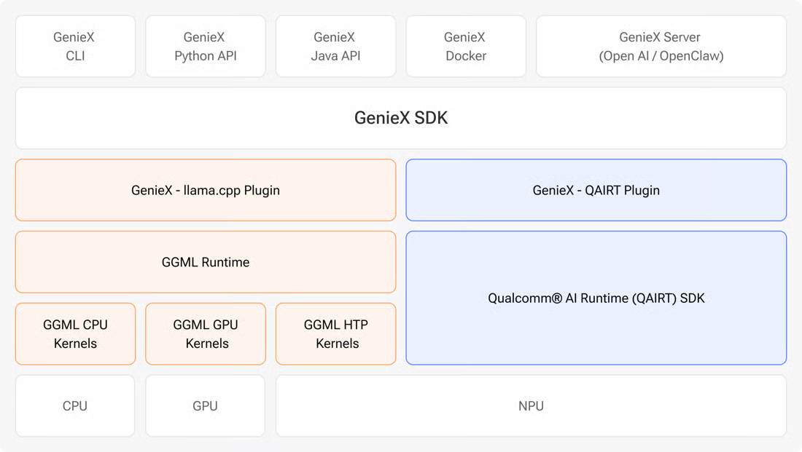

<!--
 Copyright (c) 2025 Innodisk Corp.
 
 This software is released under the MIT License.
 https://opensource.org/licenses/MIT
-->

# GenieX: Run Your Own LLM/VLM on the Platform

[GenieX](https://github.com/qualcomm/GenieX) is Qualcomm's on-device generative
AI inference runtime. It runs language models (LLMs) and vision-language models
(VLMs) locally on the Hexagon NPU, the Adreno GPU or the CPU, with no cloud
connection. This guide shows how to use it from the **CLI**, as an
**OpenAI-compatible server**, and from **Python**.

> 💡 **Tip:** GenieX powers the **[iQS-VLM](../../applications/iqs-vlm/README.md)**
> application. See it running with a live camera there, or chat with it through
> Open WebUI in the **[iQS-VLM SDK](../iqs-vlm/README.md)**.

> Note: The latest iQ-Studio requires BSP 2.5.x (QLI 2.0). On BSP 2.3.x (QLI 1.8), use tag `v0.0.10` or earlier, which uses the OGenie-based VLM demo. See the **Supported Versions** section of the [application tutorials](../../applications/README.md).

<div align="center"></div>
<p align="center"><sub>GenieX architecture. Image: <a href="https://geniex.aihub.qualcomm.com/en/get-started/what-is-geniex">GenieX documentation</a>, © Qualcomm Technologies, Inc.</sub></p>

## Runtimes

GenieX has one SDK and two runtimes. Pick the runtime that matches your model:

| Runtime | Models | Backends |
| :--- | :--- | :--- |
| **llama.cpp** | GGUF models from Hugging Face, ModelScope or Docker Hub | NPU, GPU, CPU |
| **QAIRT** (Qualcomm AI Engine Direct) | Pre-compiled bundles from [Qualcomm AI Hub](https://aihub.qualcomm.com/models) | NPU only, fastest on the NPU |

For GGUF models, choose the `Q4_0` precision for the best NPU support. The
full model list is in [Supported models](https://geniex.aihub.qualcomm.com/en/models/supported).

## Install

On the platform, run the GenieX installer:

```bash
curl -fsSL https://qaihub-public-assets.s3.us-west-2.amazonaws.com/qai-hub-geniex/install.sh | sh
```

Then check that it works:

```bash
geniex --help
```

For the prerequisites, the PATH setup and the Docker image, see the
[CLI install guide](https://geniex.aihub.qualcomm.com/en/run/cli/install) and
the [Linux (Docker) guide](https://geniex.aihub.qualcomm.com/en/run/linux/install).

## Use GenieX from the CLI

Start an interactive chat with a model. GenieX downloads the model on first use.

Run a QAIRT model from Qualcomm AI Hub on the NPU:

```bash
geniex infer ai-hub-models/Qwen2.5-VL-7B-Instruct
```

Run a GGUF model through llama.cpp on the NPU:

```bash
geniex infer Qwen/Qwen3-VL-2B-Instruct-GGUF
```

To ask a VLM about an image, put the image's full path in your prompt, for
example `Describe the image. Image: /full/path/photo.jpg`.

Useful commands and options:

| Command | What it does |
| :--- | :--- |
| `geniex pull <model>` | Download a model without starting a chat |
| `geniex list` | List the downloaded models |
| `geniex model list` | List the QAIRT models available for this chipset |
| `geniex infer <model> --compute gpu` | Run a llama.cpp model on `npu` (default), `gpu` or `cpu` |
| `geniex infer <model> -s "<prompt>"` | Set a system prompt |
| `geniex remove <model>` | Delete a downloaded model |

All commands and options are in the [CLI reference](https://geniex.aihub.qualcomm.com/en/run/cli/reference).

## Use GenieX as a Server

`geniex serve` starts an OpenAI-compatible server, so any OpenAI client can
talk to the model without code changes. It does not download models, so pull
the model first:

```bash
geniex pull ai-hub-models/Qwen3-4B-Instruct-2507
geniex serve
```

The server listens on `http://127.0.0.1:18181`. Open that address in a browser
on the platform to try the API in the built-in Swagger UI. It provides:

- `POST /v1/chat/completions`
- `POST /v1/completions`
- `GET /v1/models`

Send it a request from another terminal:

```bash
curl http://127.0.0.1:18181/v1/chat/completions \
  -H "Content-Type: application/json" \
  -d '{
    "model": "ai-hub-models/Qwen3-4B-Instruct-2507",
    "messages": [{"role": "user", "content": "Hello!"}],
    "reasoning_format": "none"
  }'
```

Or use the OpenAI Python client (`python3 -m pip install openai`):

```python
from openai import OpenAI

client = OpenAI(
    base_url="http://127.0.0.1:18181/v1",
    api_key="geniex",  # any non-empty string; the server does not check it
)

response = client.chat.completions.create(
    model="ai-hub-models/Qwen3-4B-Instruct-2507",
    messages=[{"role": "user", "content": "Briefly introduce yourself."}],
    max_tokens=128,
)
print(response.choices[0].message.content)
```

To send an image to a VLM, add an `image_url` part to the message. The URL can
be a local file path, an HTTP(S) URL or a base64 data URL:

```python
messages = [{
    "role": "user",
    "content": [
        {"type": "text", "text": "Describe the image."},
        {"type": "image_url", "image_url": {"url": "/full/path/photo.jpg"}},
    ],
}]
```

More options are in the [local server guide](https://geniex.aihub.qualcomm.com/en/run/cli/local-server).

## Use GenieX from Python

Install the Python SDK (ARM64 Python 3.10 or later):

```bash
python3 -m pip install -U geniex
```

The API follows Hugging Face `transformers`. Create `example.py`:

```python
from geniex import AutoModelForCausalLM

model = AutoModelForCausalLM.from_pretrained(
    "Qwen/Qwen3-0.6B-GGUF",
    device_map="auto",
)

messages = [{"role": "user", "content": "What is 2+2?"}]
prompt = model.tokenizer.apply_chat_template(
    messages, add_generation_prompt=True,
)

for chunk in model.generate(prompt, max_new_tokens=256, stream=True):
    print(chunk, end="", flush=True)

model.close()
```

Run it with `python3 example.py`.

To ask a VLM about an image, download a sample image:

```bash
curl -o demo.jpg https://qaihub-public-assets.s3.us-west-2.amazonaws.com/qai-hub-geniex/demo.jpg
```

Then pass it in the message and to `generate`:

```python
import os
from geniex import AutoModelForCausalLM

image_path = os.path.abspath("demo.jpg")

model = AutoModelForCausalLM.from_pretrained(
    "ai-hub-models/Qwen2.5-VL-7B-Instruct",
    device_map="qairt",
)

messages = [{
    "role": "user",
    "content": [
        {"type": "image", "image": image_path},
        {"type": "text", "text": "Describe the image."},
    ],
}]
prompt = model.tokenizer.apply_chat_template(
    messages, tokenize=False, add_generation_prompt=True,
)

for chunk in model.generate(prompt, images=[image_path], max_new_tokens=256, stream=True):
    print(chunk, end="", flush=True)

model.close()
```

The full API is in the [Python API reference](https://geniex.aihub.qualcomm.com/en/run/python/api-reference).

## Learn More

- [GenieX on GitHub](https://github.com/qualcomm/GenieX)
- [What is GenieX?](https://geniex.aihub.qualcomm.com/en/get-started/what-is-geniex)
- [Quickstart](https://geniex.aihub.qualcomm.com/en/get-started/quickstart)
- [Supported models](https://geniex.aihub.qualcomm.com/en/models/supported)
- [Report an issue](https://github.com/qualcomm/GenieX/issues)

## Copyright and License

GenieX is © 2024-2026 Qualcomm Technologies, Inc. and/or its subsidiaries, and
is released under the [BSD 3-Clause License](https://github.com/qualcomm/GenieX/blob/main/LICENSE).
Its use is subject to Qualcomm's [Terms of Use](https://www.qualcomm.com/site/terms-of-use).
The examples on this page are adapted from the
[GenieX documentation](https://geniex.aihub.qualcomm.com). Qualcomm, Hexagon and
Adreno are trademarks or registered trademarks of Qualcomm Incorporated.
