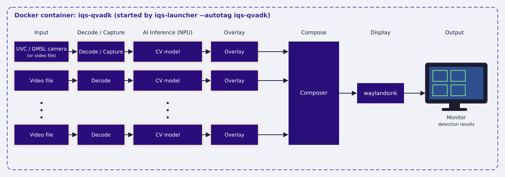
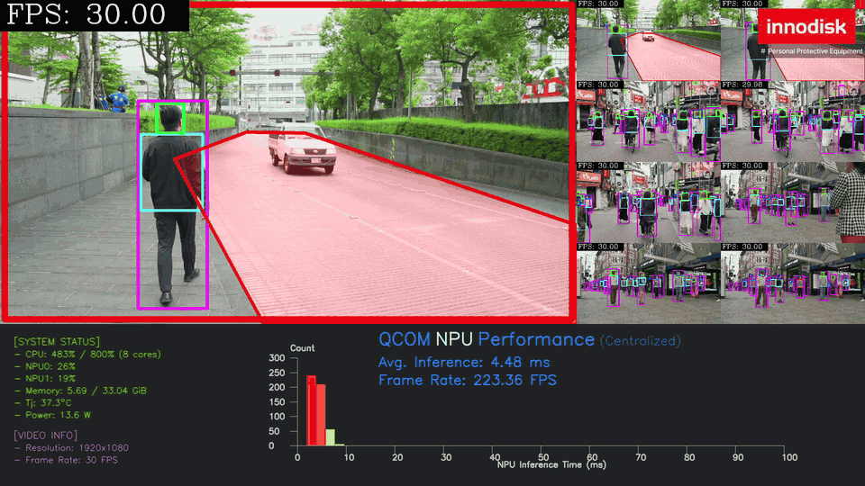
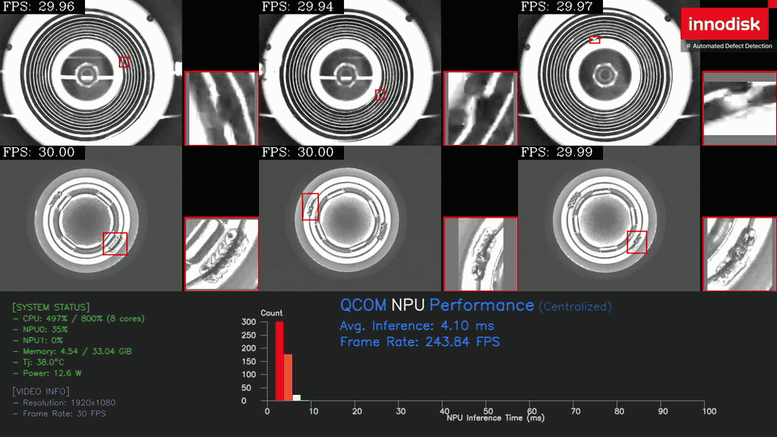
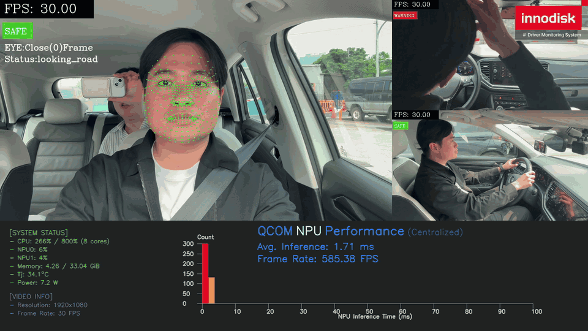
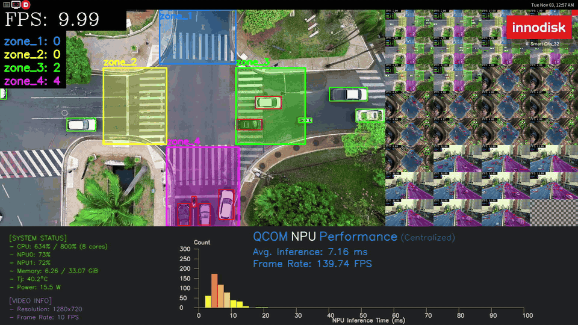
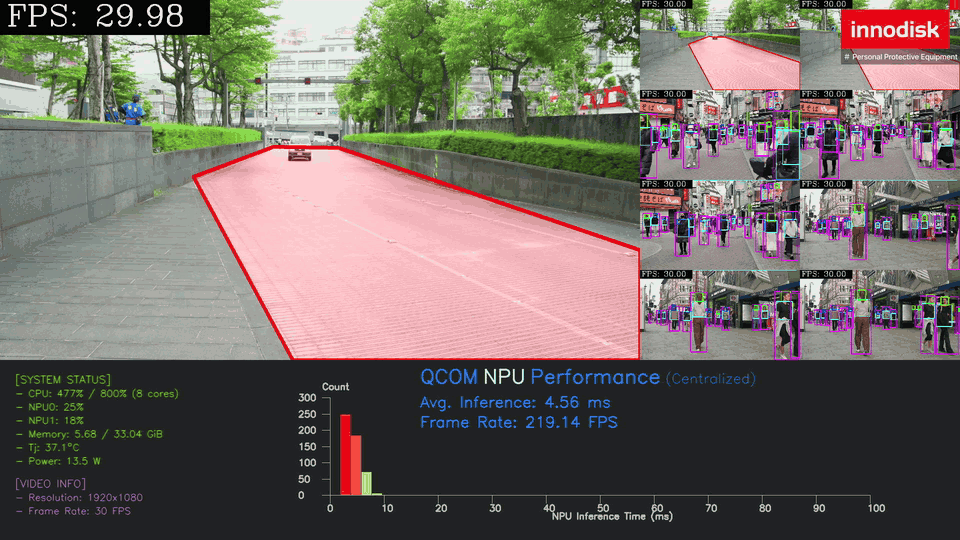
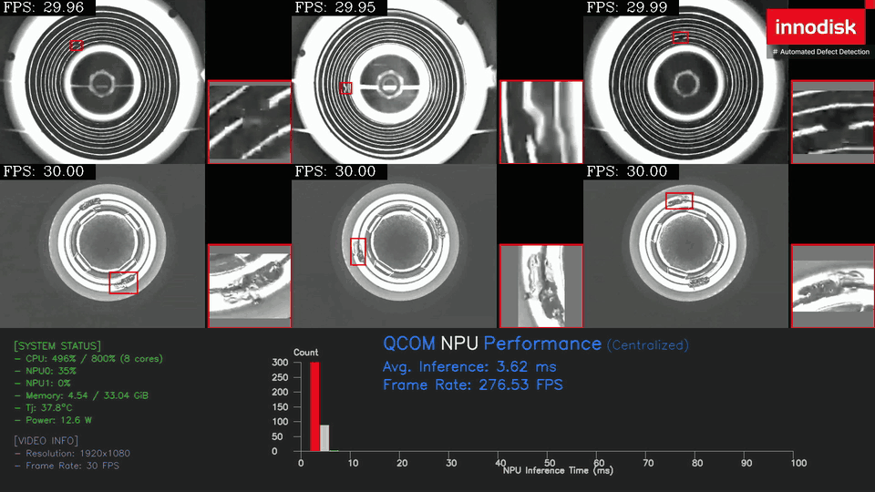
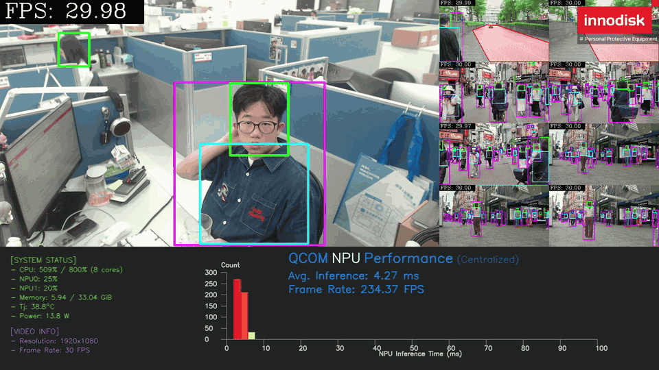
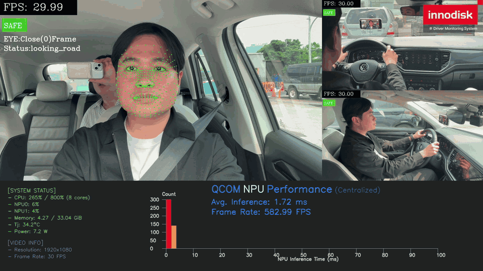
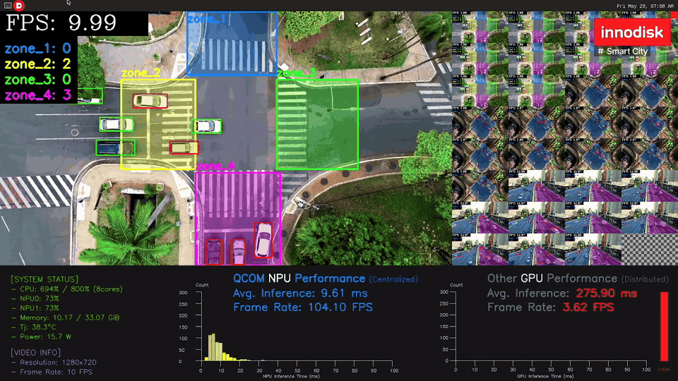

<!--
 Copyright (c) 2025 Innodisk Corp.
 
 This software is released under the MIT License.
 https://opensource.org/licenses/MIT
-->

# iQS-QVADK: Applications

This page lists the applications of iqs-qvadk and shows how to switch between them. To deploy and run iqs-qvadk for the first time, see the [application guide](../../applications/iqs-qvadk/README.md).

<br />
<div align="center"></div>
<br />

> Note: The demo GIFs may take some time to load. If one does not appear immediately, please wait.

| Application | Channels | Models (classes) | Description | Preview |
| --- | :---: | --- | --- | :---: |
| PPE | 9 | yolo26n (5) | Runs PPE and ROI person detection on 9 streams. |  |
| Defect detection | 6 | yolov10n (1) | Runs one independent YOLO model on each of 6 streams to detect screw defects on a production line. |  |
| DMS | 3 | [scrfd](https://github.com/PINTO0309/PINTO_model_zoo/tree/main/129_SCRFD) (1), [landmark](https://github.com/PINTO0309/PINTO_model_zoo/tree/main/410_FaceMeshV2) (1), resnet18 face (2), resnet18 hands (3), resnet50 body (5) | Chains face, gaze, hand and body models on each of 3 driver streams (5 models in total) and shows a warning on high-risk behavior. |  |
| Smart City | 32 | yolo26n (5) | Runs vehicle detection on 32 streams of a road intersection seen from above, counts the vehicles in each zone, and shows the NPU and GPU inference performance side by side. |  |

## How to switch and run an application

Close the running application before starting another one.

### PPE (default)

```bash
iqs-launcher --autotag iqs-qvadk
```



### Defect detection

Use `--other` to load the Defect detection config.

```bash
iqs-launcher --autotag iqs-qvadk --other "-c /app/configs/adb_config/videos/config_dd.json"
```

To go back to PPE, close the running application and run the PPE command again.



### PPE with camera

PPE can also take live input from a UVC or GMSL camera. The camera feeds the first stream; the other streams keep playing videos.

The camera configs are in this directory, which `iqs-launcher` mounts into the container as `/workspace`. Run the commands from the iqs-qvadk directory.

#### UVC camera

Requirements: at least one UVC camera with
- 1080p/30fps (1920x1080 pixels)
- MJPEG compression format
- For example, this Innodisk [USB camera](https://www.innodisk.com/en/products/camera/usb-20/ev2u-ssm1-rlcf).

```bash
cd tutorials/sdks/iqs-qvadk/
iqs-launcher --autotag iqs-qvadk --other "-c /workspace/configs/uvc/config_ppe_uvc.json"
```

#### GMSL camera

Requirements: at least one GMSL camera, with its driver installed.
1. Download the driver package for your module (for the EV3F-ZSM1, `ev3f_zsm1_pp19`) from the [iQ-Cam release page](https://github.com/InnoIPA/iQ-Cam__manifest/tree/main/release).
2. Install it by following the [iQ-Cam GMSL Camera Guide](https://github.com/InnoIPA/iQ-Cam__manifest/blob/v3.0.0/doc/common/gmsl.md).

> Note: This demo has only been tested with the EV3F-ZSM1 camera.

```bash
cd tutorials/sdks/iqs-qvadk/
iqs-launcher --autotag iqs-qvadk --other "-c /workspace/configs/gmsl/config_ppe_gmsl.json"
```



## Other applications (preview only)

The following applications are shown for demonstration only.

### DMS



### Smart City


