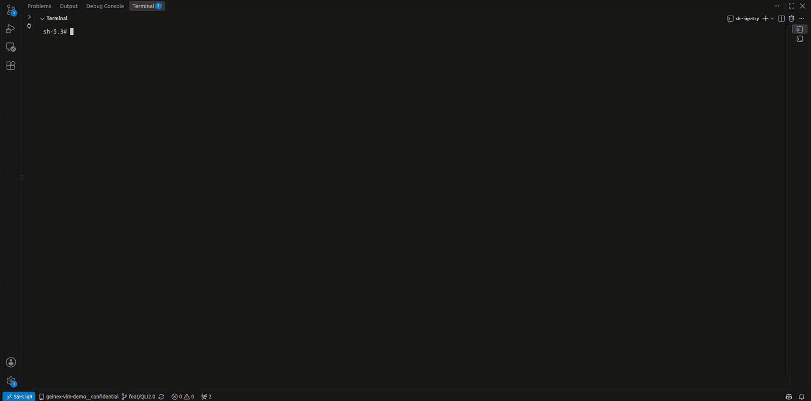
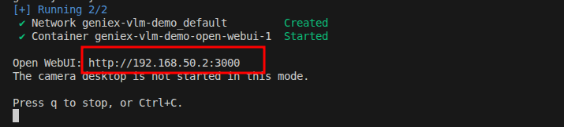

<!--
 Copyright (c) 2025 Innodisk Corp.
 
 This software is released under the MIT License.
 https://opensource.org/licenses/MIT
-->

# iQS-VLM: Chat with the VLM through Open WebUI

> If you haven't tried our iqs-vlm application yet, we recommend visiting this [page](../../applications/iqs-vlm/README.md) first, then returning here for customization options and other advanced features.

> Note: The latest iQ-Studio requires BSP 2.5.x (QLI 2.0). On BSP 2.3.x (QLI 1.8), use tag `v0.0.10` or earlier, which uses the OGenie-based VLM demo. See the **Supported Versions** section of the [application tutorials](../../applications/README.md).

Besides the live camera demo, iQS-VLM has a chat mode. It runs the same model,
powered by [GenieX](https://github.com/qualcomm/GenieX), behind
[Open WebUI](https://github.com/open-webui/open-webui), so you can chat with the
model and send it your own images from a browser on your development machine.



Chat mode needs no camera and no monitor.

# Chat with the VLM

1. Start the demo in chat mode on the platform:

   ```bash
   iqs-launcher --autotag iqs-vlm-demo --other "--mode chat"
   ```

   This runs **Qwen3-VL-4B** on the NPU. To chat with **LFM2.5-VL-450M**
   instead, add the runtime and the backend (`NPU`, `CPU`, `GPU` or `HYBRID`):

   ```bash
   iqs-launcher --autotag iqs-vlm-demo --other "--mode chat --runtime GenieX-llama.cpp --backend NPU"
   ```

   > Note: The first chat start downloads the Open WebUI image, which takes a
   > while. Later starts use the downloaded image.

2. When the model is ready, the terminal prints the Open WebUI address,
   `http://<device_ip>:3000`. Open it in a browser on your development machine.

   

3. Open WebUI opens with the model already selected. Type a message, or attach
   an image with `+`, and start chatting!

To stop chat mode, press `q` or `Ctrl+C` in the terminal.

# Technical Details

1. Chat mode starts the model and an OpenAI-compatible API server on port
   `8000`, then starts Open WebUI on port `3000` as a separate container
   connected to it. Your chats and settings are kept between runs.

2. You can also call the API directly, for example to list the model that is
   running:

   ```bash
   curl http://<device_ip>:8000/v1/models
   ```

   It implements `GET /v1/models` and `POST /v1/chat/completions`. For the
   request format, see the
   [OpenAI Chat Completions API](https://platform.openai.com/docs/api-reference/chat).

3. Logs are saved on the platform in `/var/lib/iqs-vlm-demo/logs`. To follow
   them live while the demo runs, open another terminal on the platform:

   ```bash
   tail -f /var/lib/iqs-vlm-demo/logs/gateway.log
   ```

   | Log file | What it shows |
   | :--- | :--- |
   | `gateway.log` | API requests from Open WebUI and the responses |
   | `geniex.stdout.log`, `geniex.stderr.log` | Model loading and inference output from GenieX |
   | `lifecycle.log` | Startup and shutdown steps |
