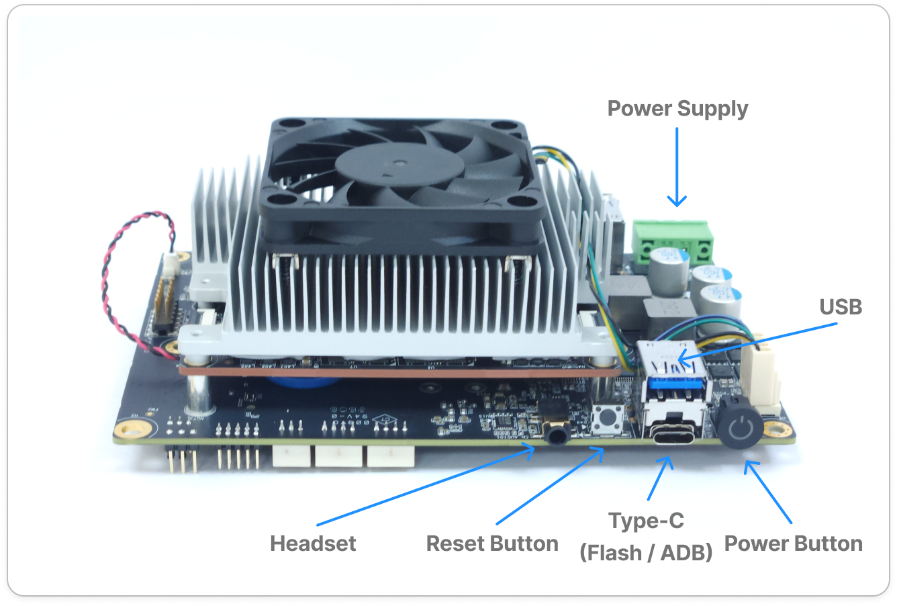
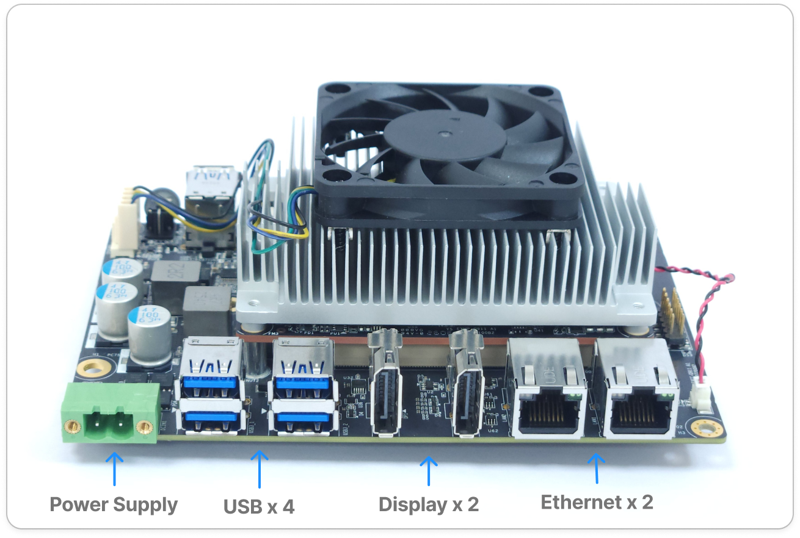
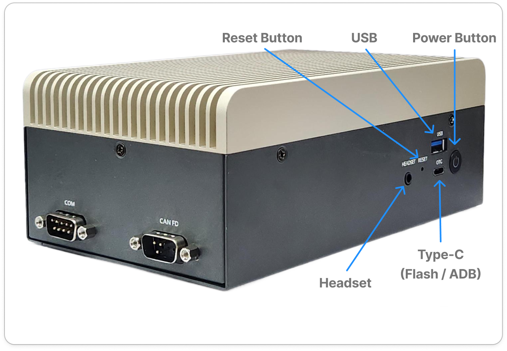
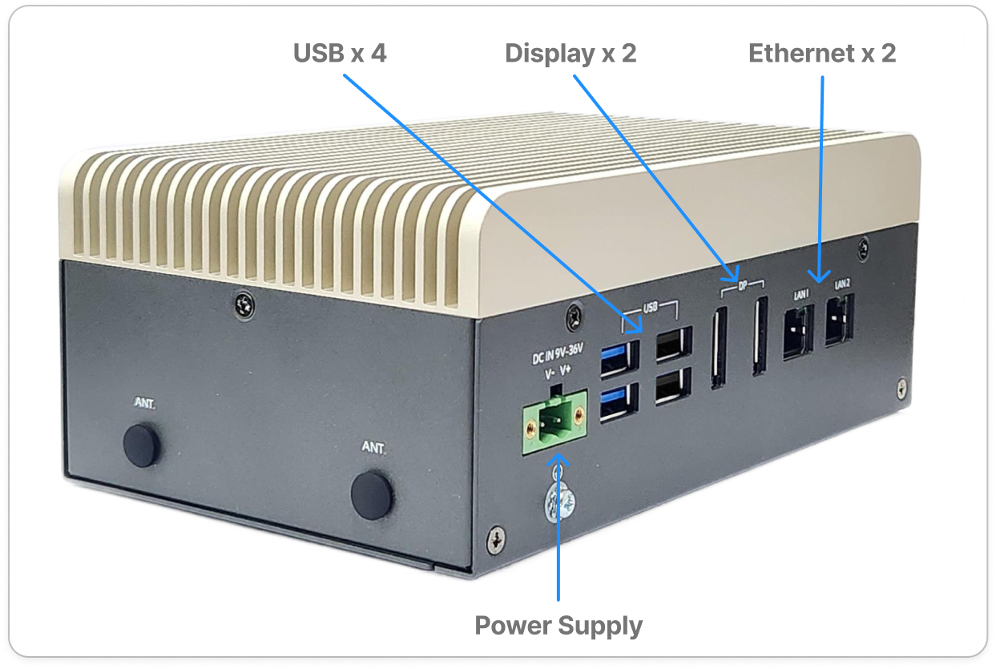
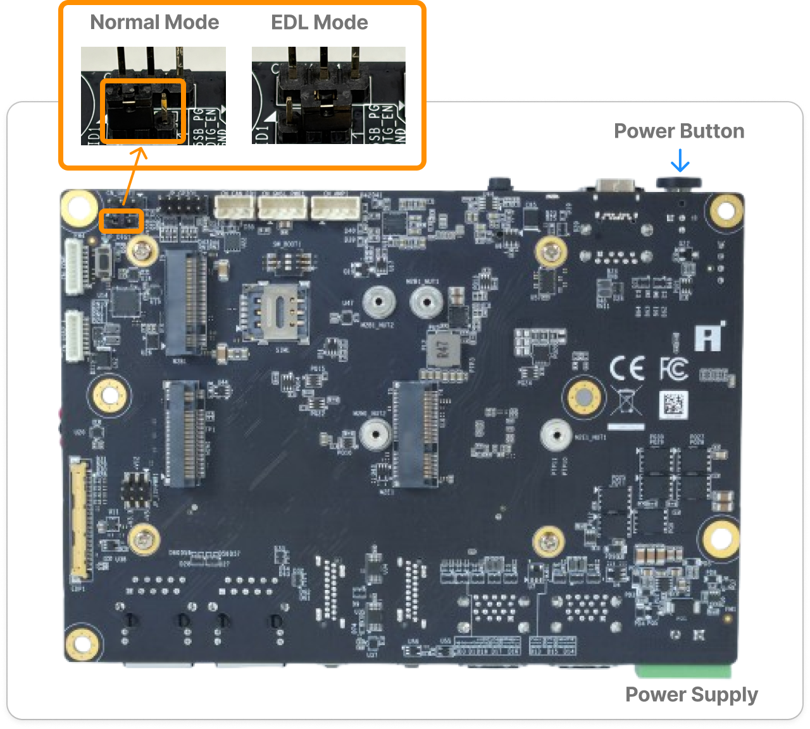
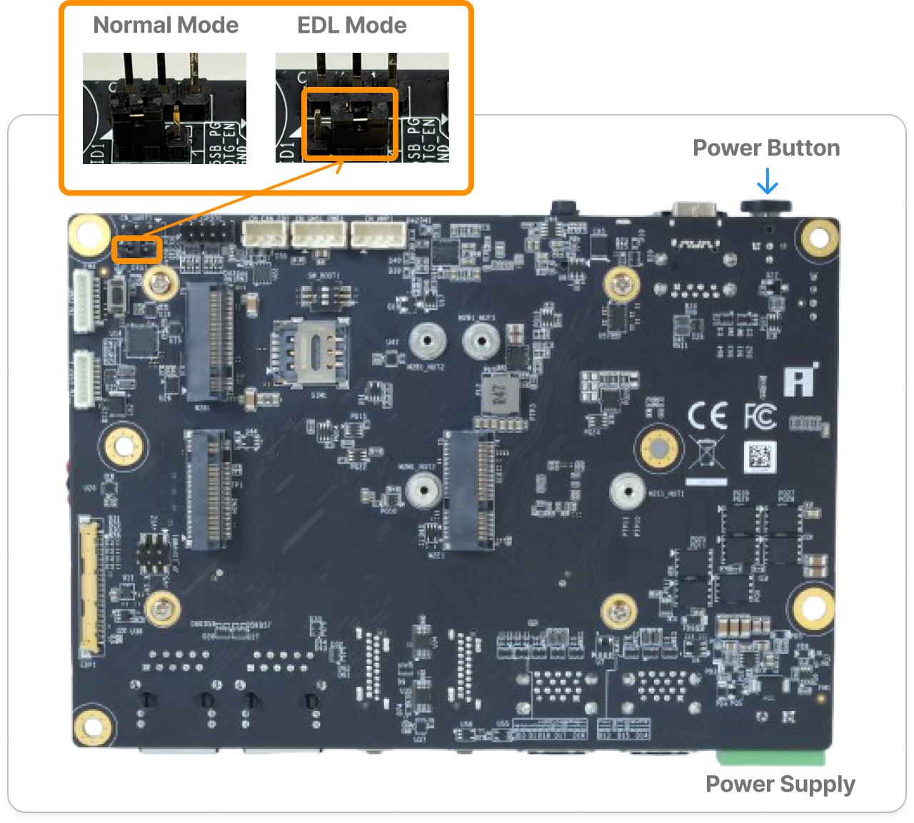
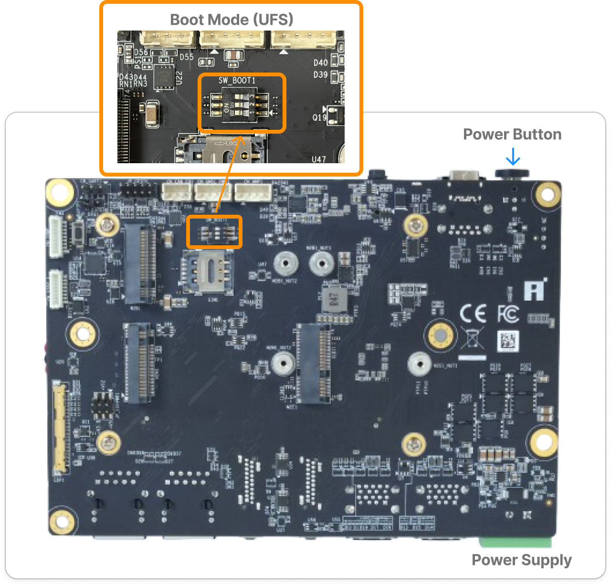
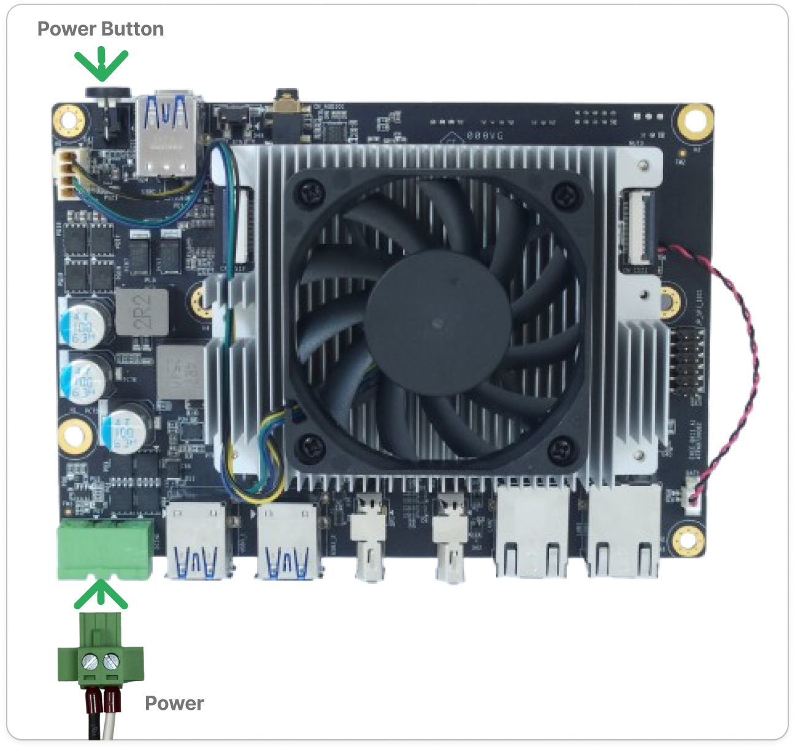
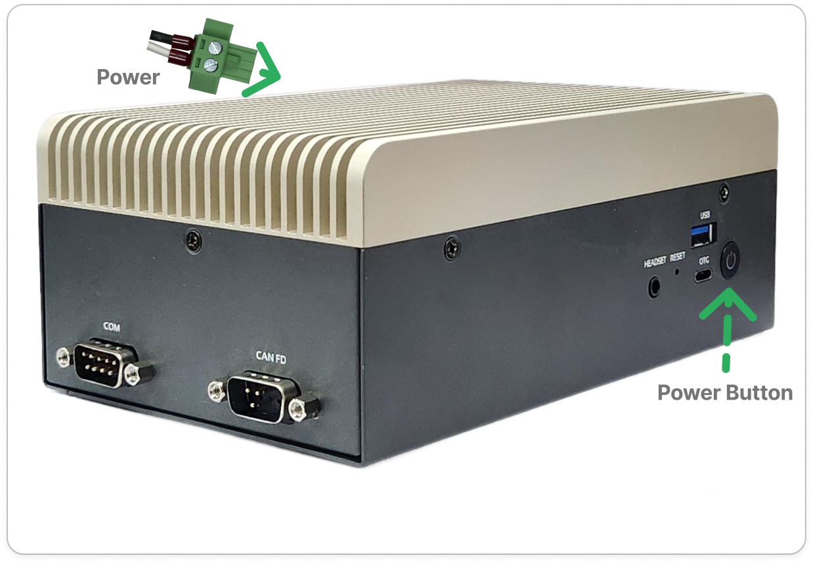

# Q911 Platform Quick Start Guide

## Overview
The Q911 family is built around the Qualcomm® IQ-9075 SoC. The product line currently has three versions. The table below provides an overview of their differences and the items included in each packing list.

| **Model** | **P/N** | **Description** | **Packing List** |
| --- | --- | --- | --- |
| [EXMP-Q911](https://www.innodisk.com/en/products/computing/qualcomm-solution/exmp-q911) | EXMP-Q911-00A1-W1 | COM-HPC Mini Module By Qualcomm IQ-9075 | 1x IQ9 COM-HPC Mini Module   1x Cooler with Fan (secured onto the module) |
| [EXEC-Q911](https://www.innodisk.com/en/products/computing/qualcomm-solution/exec-q911) | EXEC-Q911-00A1-W1 | COM-HPC Mini EVK By Qualcomm IQ-9075| 1x IQ9 COM-HPC Mini Module   1x 3.5” COM-HPC Mini Carrier (secured with the module)   1x Cooler with Fan (secured onto the module)   1x 60W power adapter   1x US power cord   1x Speaker*2 cable   1x D-SUB(F) cable (GPIO)   1x D-SUB(M) cable (CAN FD)   1x USB 2.0 A-TYPE(F)*2 cable   1x D-SUB(M) cable (COM) |
| APEX-A100 | EXOC-Q911-00A1-W1 | Edge AI System By Qualcomm IQ-9075| 1x Fanless Edge AI System based on EXMP-Q911 module   1x 60W power adapter   1x US power cord |

This guide focuses on the EXEC-Q911 and APEX-A100 platforms, providing an overview of their hardware and helping you get the system up and running quickly.

## BSP Version

- **Yocto Linux**: released versions and the version rules are published in the [meta-iQ__manifest release table](https://github.com/InnoIPA/meta-iQ__manifest).
- **Ubuntu**: released versions and the version-numbering rules are published in the [iQ-ubuntu__manifest release table](https://github.com/InnoIPA/iQ-ubuntu__manifest) (no longer maintained since v2.5.1; merged into [meta-iQ__manifest](https://github.com/InnoIPA/meta-iQ__manifest)).

> Note: Yocto Linux ships pre-flashed on UFS. Ubuntu is not pre-flashed by default and requires the Innodisk-ported image (flashed via the [Q911 Image Flashing Guide](../flash-image/README.md)) to keep all IO functions working correctly.

## What’s in the Box

You can refer to the packing list above to see what is included in the Q911 family.

## EXEC-Q911 / APEX-A100 Hardware 

  <table>
    <tr>
      <td align="center"  width="50%" valign="bottom">
        
      </td>
      <td align="center"  width="50%" valign="bottom">
        
      </td>
    </tr>
    <tr>
      <td align="center">EXEC-Q911 Front</td>
      <td align="center">EXEC-Q911 Back</td>
    </tr>
  </table>

  <table>
    <tr>
      <td align="center"  width="50%" valign="bottom">
        
      </td>
      <td align="center"  width="50%" valign="bottom">
        
      </td>
    </tr>
    <tr>
      <td align="center">APEX-A100 Front</td>
      <td align="center">APEX-A100 Back</td>
    </tr>
  </table>

## Step 1: Prepare Required Items

Before you get started, please make sure you have the following items:

- DisplayPort (DP) monitor  
- USB keyboard & mouse  
- Ethernet cable 
- USB Type-C cable
- USB-to-TTL serial adapter  
- 60W power adapter

## Step 2: Power On

Please follow the steps below to boot the system.

1. Please ensure that the jumper on the bottom side of the board is set to `Normal mode`.
`EDL mode` should be used when flashing the system image.

  

    <table>
      <tr>
        <td align="center" width="50%" valign="bottom">
          
        </td>
        <td align="center" width="50%" valign="bottom">
          
        </td>
      </tr>
      <tr>
        <td align="center">Normal mode</td>
        <td align="center">EDL mode</td>
      </tr>
    </table>
  

2. Please ensure that all boot mode DIP switches are set to `ON`, so the system boots from `UFS`.

   

    
  

3. Connect the power supply and press the power button to boot the system.

  

    <table>
      <tr>
        <td align="center"  width="50%" valign="bottom">
          
        </td>
        <td align="center"  width="50%" valign="bottom">
          
        </td>
      </tr>
      <tr>
        <td align="center">EXEC-Q911</td>
        <td align="center">APEX-A100</td>
      </tr>
    </table>
  

## Interact with the System

After the system boots, the supported access methods are DisplayPort monitor, SSH over Ethernet, ADB over USB Type-C, and UART Debug Console. The login table, default credentials, and per-method connection steps live in the OS-specific guides:

- [**Yocto Linux**](./yocto.md#interact-with-the-system)
- [**Ubuntu**](./ubuntu.md#interact-with-the-system)

## Next Steps

- [Application](../../applications/README.md) — Reference ready-to-run demos illustrating how to build applications on the platform.

- [SDK](../../sdks/README.md)  — Learn how to develop and integrate your own solutions with the platform SDK.

- [AVL(Approved Vendor List)](../../avl/README.md) — Provides guidance on verifying that the driver starts correctly on the system and quickly demonstrating the validated results.

- [Benchmark](../../../benchmarks/README.md) — Review performance metrics for AI and system workloads.
