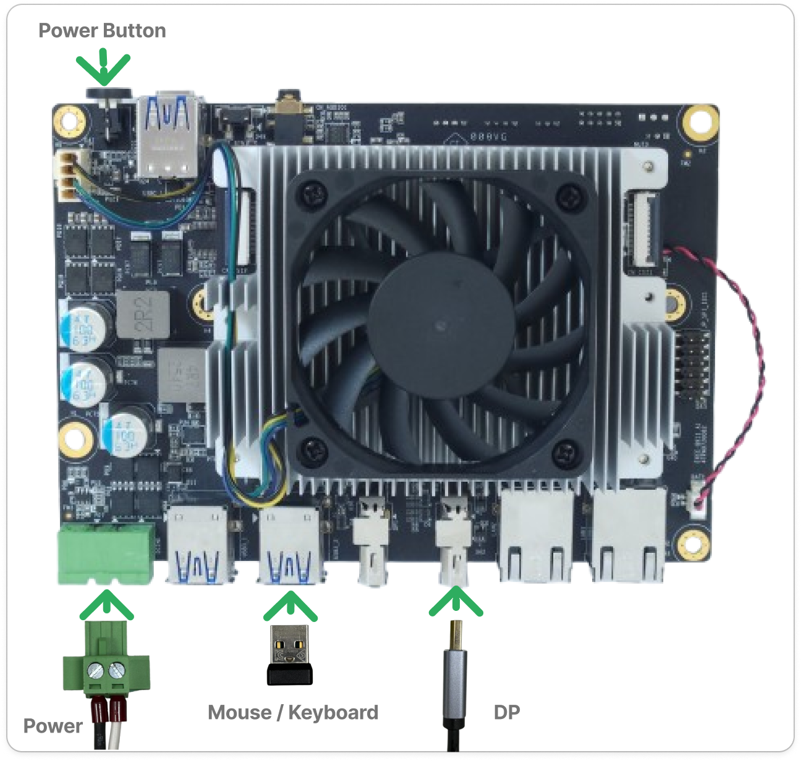
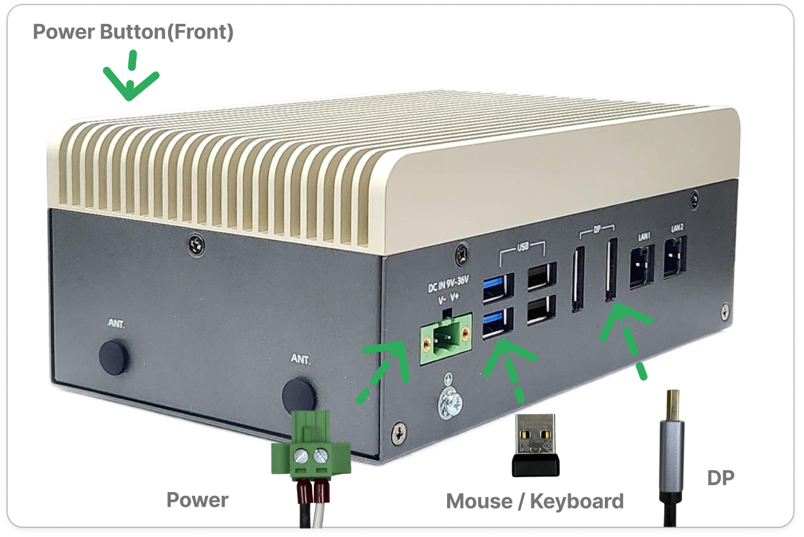
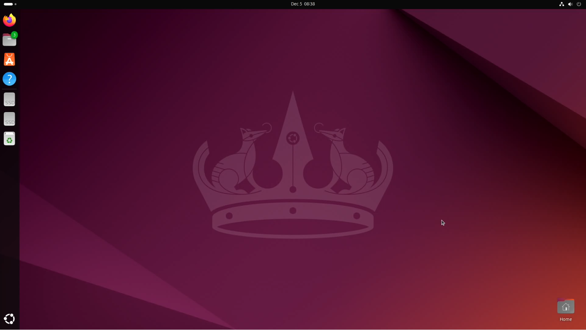
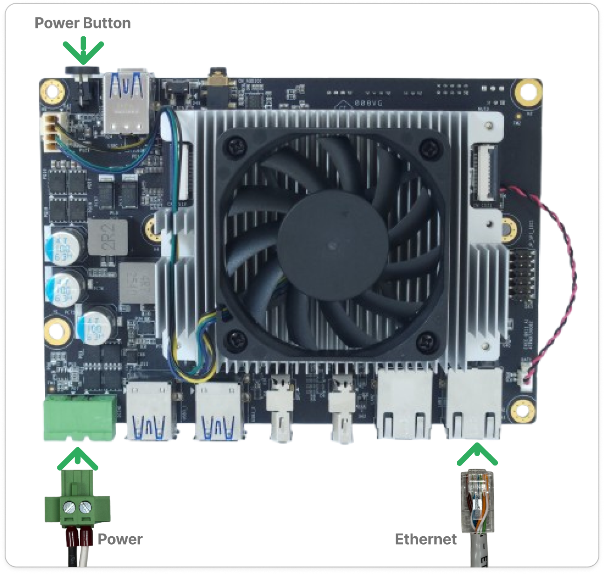
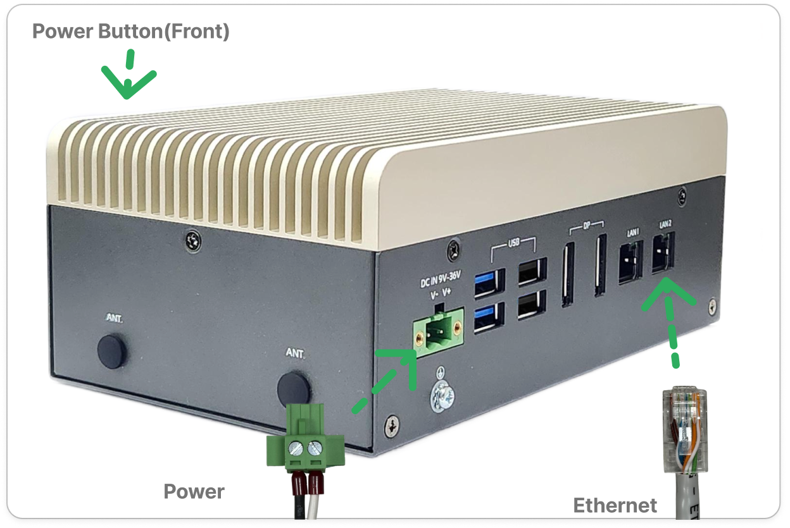
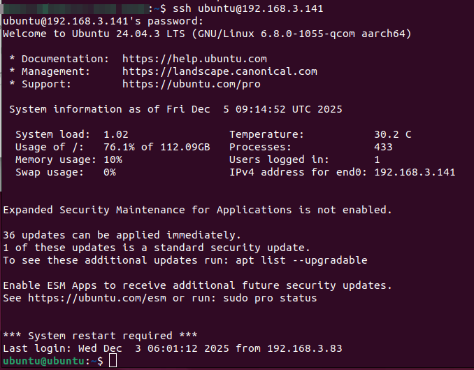
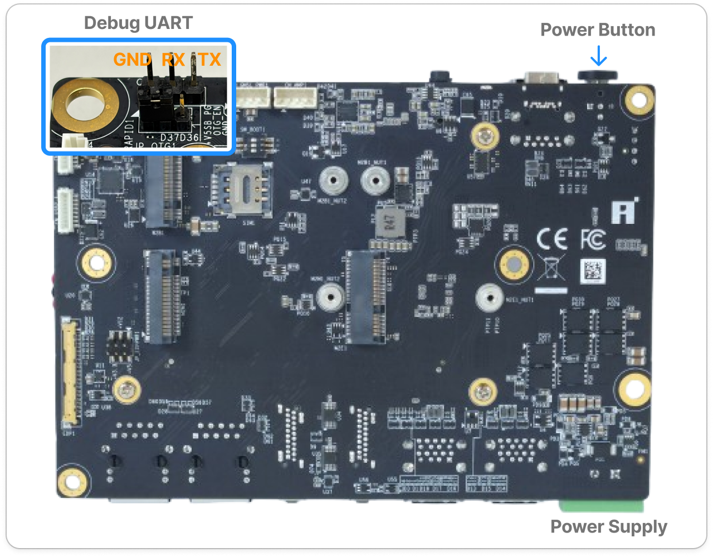
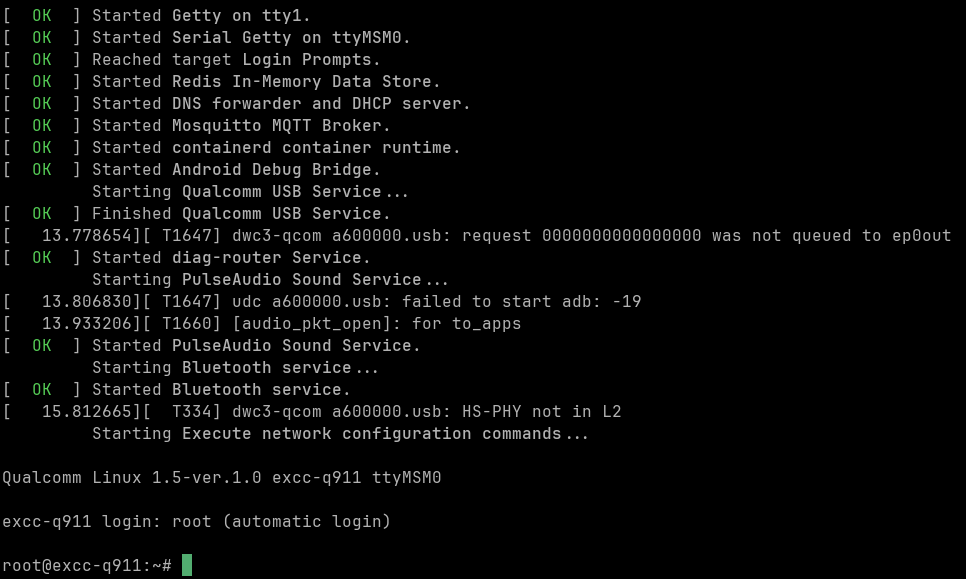

# Q911 — Ubuntu Interaction Guide

This guide covers system interaction on Ubuntu, using the Innodisk-ported image tracked in [iQ-ubuntu__manifest](https://github.com/InnoIPA/iQ-ubuntu__manifest) (no longer maintained since v2.5.1; merged into [meta-iQ__manifest](https://github.com/InnoIPA/meta-iQ__manifest)).

> Prerequisite: flash an Innodisk-provided Ubuntu image via the [Q911 Image Flashing Guide](../flash-image/README.md), then complete [Prepare Required Items](./README.md#step-1-prepare-required-items) and [Power On](./README.md#step-2-power-on) in the Q911 Quick Start Guide.

## Interact with the System

After the system boots, you can access the platform using one of the following methods:

- DisplayPort monitor
- SSH over Ethernet
- ADB over USB Type-C (Not supported on Ubuntu)
- UART Debug Console

| Usage Method | Login Required |
| --- | --- |
| Desktop | Yes |
| SSH | Yes |
| ADB | Not supported |
| UART | Yes |

### First-Boot Network Setup

> Notice: Ubuntu does not bring up Ethernet on first boot. Before any network operation, install the `iq-ubuntu*.deb` post-flash networking package — install steps in the [iQ-ubuntu__manifest debian package part](https://github.com/InnoIPA/iQ-ubuntu__manifest).

### Default Credentials

```bash
Username: ubuntu
Password: ubuntu
```

### Interact with the System Using a DP Display

1. Connect the DP display and USB keyboard/mouse. Then power on the system (see [Power On](./README.md#step-2-power-on)).

  <div align="center">
  <table>
    <tr>
      <td align="center"  width="50%" valign="bottom">
        
      </td>
      <td align="center"  width="50%" valign="bottom">
        
      </td>
    </tr>
    <tr>
      <td align="center">EXEC-Q911</td>
      <td align="center">APEX-A100</td>
    </tr>
  </table>
  </div>


2. After the device boots up, you should see the output displayed on the DisplayPort (DP) monitor. In Ubuntu, you can interact with the system just as you would on a standard amd64 Ubuntu installation.

     <p align="center">
      
    </p>

### Interact with the System Using SSH over Ethernet
> Note: If networking is unavailable on first login, install the `iq-ubuntu*.deb` package — see [First-Boot Network Setup](#first-boot-network-setup) above.

1. Connect an Ethernet cable and ensure that the device is reachable over the network. Then power on the system.

<div align="center">
  <table>
    <tr>
      <td align="center"  width="50%" valign="bottom">
        
      </td>
      <td align="center"  width="50%" valign="bottom">
        
      </td>
    </tr>
    <tr>
      <td align="center">EXEC-Q911</td>
      <td align="center">APEX-A100</td>
    </tr>
  </table>
</div>

2. After the device boots up, you can access the device via SSH from any machine on the same network. Use the following command to connect to Ubuntu:

    ```bash
    ssh ubuntu@<target device ip address>
    ```

     <p align="center">
      
    </p>

### Interact with the System Using ADB over USB Type-C

> Note: ADB is not supported on Ubuntu. Use DP, SSH, or UART instead.

### Interact with the System Using UART Debug Console

> 💡 **Tip:** You can refer to the [Qualcomm guide on setting up a debug UART](https://docs.qualcomm.com/doc/80-70014-253/topic/ubuntu_host.html#set-up-debug-uart) for detailed instructions on how to connect using minicom.

1. Connect the USB-to-TTL serial adapter to the UART pins on the bottom side of the board. Then power on the system.


  <p align="center">
    
  </p>

  > 💡 **Tip:** Set your serial terminal to 115200 baud, 8 data bits, no parity, 1 stop bit, no flow control

2. After the device boots up, you will see a screen similar to the one shown below.

  <p align="center">
    
  </p>

